# POS-Kasir — Desktop Retail Minimarket Point-of-Sale System

[](https://github.com/bimadevs/pos-kasir/actions/workflows/build-windows.yml)
[](https://github.com/bimadevs/pos-kasir/releases/latest)


-0078D6?style=flat-square&logo=windows&logoColor=white)

**POS-Kasir** adalah aplikasi *Point-of-Sale* (kasir) desktop *offline-first* berkinerja tinggi untuk operasional ritel minimarket, dibangun menggunakan **Tauri v2 (Rust)** pada sisi backend dan **React 19 + TypeScript + Tailwind CSS v4** pada sisi frontend.

Aplikasi ini dirancang dengan arsitektur **Dual-Mode LAN** dalam satu paket instalasi (*single binary installer*): komputer kasir utama dapat beroperasi sebagai **Server Terminal** (menyimpan database SQLite `WAL` terpusat dan menjalankan server HTTP `Axum` di jaringan lokal), sementara 3–5 komputer kasir tambahan dapat terhubung secara *real-time* sebagai **Client Terminal** tanpa memerlukan koneksi internet maupun instalasi server database terpisah.

---

## Unduh Installer Windows 10/11 (64-bit)

Setiap *push* ke branch `main` secara otomatis diuji dan di-*build* menggunakan **GitHub Actions (`windows-latest`)** mengikuti standar **SemVer Lockstep** menjadi 3 format siap pakai:

- [**Halaman GitHub Releases (Unduh `.exe` & `.msi` Terbaru)**](https://github.com/bimadevs/pos-kasir/releases/latest)
  - `pos-kasir_<versi>_x64-setup.exe` — Installer standar Windows (NSIS — **Direkomendasikan**).
  - `pos-kasir_<versi>_x64_en-US.msi` — Paket installer Windows MSI.
  - `pos-kasir.exe` — File *portable executable* (langsung jalan tanpa instalasi).
- [**Catatan Perubahan Versi (`CHANGELOG.md`)**](CHANGELOG.md)
- [**GitHub Actions Workflow Runs & Artifacts**](https://github.com/bimadevs/pos-kasir/actions/workflows/build-windows.yml)

---

## Fitur Utama

### 1. Topologi Dual-Mode LAN (`Server Terminal` & `Client Terminal`)
- **First-Run Setup Wizard**: Saat dijalankan pertama kali (`UNCONFIGURED`), aplikasi memandu pemilihan peran terminal (**Server Terminal** atau **Client Terminal**).
- **Sinkronisasi Real-Time via LAN**: Seluruh terminal kasir membaca stok produk yang sama, memproses transaksi secara atomik, dan berbagi antrean **Held Bill** melalui REST API lokal (`Axum` port `9876`) yang diamankan dengan **Pairing Code** (`X-Setup-Pairing-Code`) dan token sesi pengguna.
- **Proteksi Penutupan Server (`System Tray`)**: Menutup jendela aplikasi pada **Server Terminal** otomatis menyembunyikan aplikasi ke *System Tray* agar koneksi kasir **Client Terminal** lain tidak terputus secara tidak sengaja.

### 2. Ergonomi Kasir *Keyboard-First* & *USB HID Barcode Scanner*
- **Global Barcode Scanner Hook**: Mendeteksi *keystroke burst* dari pemindai barcode USB HID (`< 40ms` antar karakter, diakhiri `Enter`) secara otomatis dari mana saja di layar kasir tanpa harus mengklik kolom pencarian terlebih dahulu.
- **Navigasi 100% Tanpa Mouse (`F1`–`F10`)**: Seluruh siklus transaksi—mulai dari cari barang, ubah kuantitas, tahan transaksi (*Hold*), panggil transaksi (*Recall*), hingga pembayaran tunai uang pas—dapat dieksekusi sepenuhnya menggunakan tombol fungsi keyboard.
- **Tactile Retail Hybrid UI**: Menggabungkan area kerja terang anti-silau (`#F1F5F9` / `#FFFFFF`) untuk keterbacaan tabel berjam-jam dengan panel ringkasan pembayaran kontras tinggi (`#0F172A`) dan *badge* tombol mekanikal (`[F1]`–`[F10]`).

### 3. Mesin Transaksi Atomik & Akurasi Finansial (`BR-01`..`BR-03`)
- **Kontrol Konkurensi `BEGIN IMMEDIATE`**: Setiap pembuatan transaksi penjualan (`create_sale`) mengunci transaksi tulis SQLite secara instan, memvalidasi stok terkini, memotong stok, dan mencatat item penjualan secara atomik (mencegah *overselling* saat beberapa kasir memindai produk terakhir secara bersamaan).
- **Blokir Keras Stok Habis (`stock == 0`)**: Produk dengan stok `0` atau kuantitas melebihi sisa stok ditolak secara tegas baik di tingkat UI (dengan peringatan visual & *audio buzzer* Web Audio API) maupun di tingkat backend Rust.
- **Snapshot Harga & HPP Abadi (*Immutable Snapshot*)**: Setiap baris transaksi menyimpan salinan `cost_price_snapshot`, `selling_price_snapshot`, dan `unit_discount_amount` pada detik transaksi terjadi. Perubahan harga modal atau harga jual di masa depan tidak akan pernah mengubah perhitungan **Laba Kotor (Gross Profit)** historis.

### 4. Held Bill, Reprint, & Void dengan Otorisasi PIN Admin
- **Hold & Recall Lintas Terminal (`F4` / `F5`)**: Kasir dapat menahan keranjang belanja pelanggan sementara ke **Server Terminal** tanpa mengunci stok fisik, lalu memanggilnya kembali dari meja kasir mana pun dengan validasi ulang ketersediaan stok terkini.
- **Void Transaksi Hari Ini (`F6`)**: Pembatalan transaksi yang sudah selesai pada hari yang sama wajib menyertakan alasan pembatalan dan diverifikasi menggunakan **PIN Admin (4–6 digit)** yang di-hash dengan **Argon2id**, lalu mengembalikan stok barang secara otomatis dan atomik.

### 5. Pencetakan Struk Raw ESC/POS (58mm / 80mm) & Cash Drawer RJ11
- **Generator Byte ESC/POS Mandiri**: Memformat struk 58mm (32 karakter/baris) dan 80mm (48 karakter/baris), menyertakan penanda `*** CETAKAN ULANG ***` saat *reprint*, serta mengirimkan sinyal *kick pulse* (`0x1B 0x70`) untuk membuka laci uang RJ11.
- **Win32 Print Spooler & Virtual Thermal Printer Simulator**: Mengirim *raw bytes* langsung ke printer thermal USB/LPT melalui API native Windows (`winspool.drv`), serta menyediakan **POS-Kasir Virtual Thermal Printer (Simulasi)** lengkap dengan modal pratinjau struk thermal di layar untuk pengujian tanpa perangkat keras fisik.

### 6. Modul Administrasi Toko, CSV Atomik, & Online Backup SQLite
- **Katalog Produk & Diskon**: Kelola SKU, barcode, HPP (*cost price* — disembunyikan dari peran `CASHIER`), harga jual, diskon (`NONE`, `NOMINAL`, `PERCENT`), serta **Import/Export CSV** dengan *rollback* atomik jika terdapat baris CSV yang tidak valid.
- **Penyesuaian Stok (*Stock Adjustment*)**: Pencatatan barang masuk (`RESTOCK`), rusak (`DAMAGE`), hilang (`LOSS`), dan koreksi opname (`CORRECTION`) beserta log audit lengkap.
- **Laporan Penjualan & Laba Kotor**: Filter berdasarkan rentang tanggal, kasir, dan terminal; ringkasan Omzet Bersih, Total Diskon, Total HPP, Laba Kotor, produk terlaris, peringatan stok menipis ($\le 5$), serta ekspor laporan ke CSV.
- **Backup & Restore Database Online**: Mencadangkan database SQLite secara aman saat server sedang aktif menggunakan perintah `VACUUM INTO`.

---

## Arsitektur Sistem

```mermaid
flowchart LR
    subgraph ClientPC["Client Terminal (Kasir 2..N)"]
        C_UI["React 19 + TypeScript UI"]
        C_IPC["Tauri v2 IPC Commands"]
        C_DISP["BackendDispatcher (Mode: CLIENT)"]
        C_HW["Local ESC/POS & Spooler"]
        C_UI --> C_IPC --> C_DISP
        C_IPC --> C_HW
    end

    subgraph ServerPC["Server Terminal (Kasir Utama)"]
        S_UI["React 19 + TypeScript UI"]
        S_IPC["Tauri v2 IPC Commands"]
        S_DISP["BackendDispatcher (Mode: SERVER)"]
        S_AXUM["Axum HTTP LAN Server (:9876)"]
        S_CORE["CoreService & AuthService"]
        S_DB[("SQLite 3 (WAL Mode)")]
        S_HW["Local ESC/POS & Spooler"]

        S_UI --> S_IPC --> S_DISP --> S_CORE
        S_AXUM --> S_CORE --> S_DB
        S_IPC --> S_HW
    end

    C_DISP -- "HTTP JSON /api/v1/* (LAN)" --> S_AXUM
```



---

## Pintasan Keyboard Kasir (`PosRegisterPage`)

| Tombol | Fungsi Operasional |
| :--- | :--- |
| <kbd>F1</kbd> | Fokus ke kolom pencarian produk / input manual barcode & SKU |
| <kbd>F2</kbd> | Ubah kuantitas (*Qty*) pada baris keranjang yang sedang dipilih |
| <kbd>↑</kbd> / <kbd>↓</kbd> | Navigasi memilih baris item di dalam keranjang belanja |
| <kbd>Delete</kbd> | Hapus baris item yang dipilih dari keranjang |
| <kbd>F4</kbd> | **Hold Bill** — Tahan keranjang belanja saat ini ke antrean sementara |
| <kbd>F5</kbd> | **Recall Bill** — Buka daftar transaksi yang ditahan untuk dipanggil kembali |
| <kbd>F6</kbd> | Buka panel **Riwayat Transaksi Hari Ini**, **Reprint**, & **Void (PIN Admin)** |
| <kbd>F8</kbd> | Buka modal **Pembayaran Tunai (Cash)** & kalkulator uang kembalian |
| <kbd>F9</kbd> | **Bayar Cepat Uang Pas** (*Quick Exact Cash*) & langsung cetak struk |
| <kbd>F10</kbd> | **Cetak Ulang (*Reprint*)** struk transaksi terakhir |
| <kbd>Esc</kbd> | Tutup modal aktif / batalkan edit kuantitas / bersihkan pencarian |

---

## Tech Stack

| Lapisan | Teknologi |
| :--- | :--- |
| **Desktop Runtime** | [Tauri v2](https://v2.tauri.app/) (Rust Backend + OS Native WebView) |
| **Frontend** | React 19, TypeScript 5.8, Vite, Tailwind CSS v4, Lucide Icons |
| **Backend & Concurrency** | Rust (2021 Edition), Tokio (Async Runtime), Axum 0.8 (LAN HTTP Server), Reqwest (LAN HTTP Client) |
| **Database** | SQLite 3 via `rusqlite` (`bundled`, `journal_mode = WAL`, `foreign_keys = ON`) |
| **Keamanan & Kriptografi** | Argon2id (`argon2` + `password-hash`) untuk Password & PIN Otorisasi Admin |
| **Perangkat Keras** | Raw ESC/POS Byte Builder, Win32 Print Spooler (`windows-sys`), Virtual Thermal Printer Simulator, Web Audio API |
| **Pengujian Otomatis** | Rust `cargo test` (Unit & LAN Integration Tests) + `Vitest` (Frontend Domain Tests) |

---

## Struktur Direktori

```text
pos-kasir/
├── docs/                       # Dokumentasi Spec-Driven Development (SDD) & ADR
│   ├── adr/                    # Architecture Decision Records (ADR-0001..0004)
│   ├── PRD.md                  # Product Requirements Document
│   ├── REQUIREMENTS.md         # Aturan Bisnis (BR-01..03), FR-*, & NFR-*
│   ├── ARCHITECTURE.md         # Topologi Dual-Mode LAN & Komponen Sistem
│   ├── SYSTEM-DESIGN.md        # Skema SQLite DDL, Kontrak API, & Protokol ESC/POS
│   ├── UI-UX-SPEC.md           # Spesifikasi Wireframe, Shortcut F1-F10, & Barcode Hook
│   └── CONTEXT.md              # 10 Invarian Domain & Strategi Verifikasi
├── src/                        # Frontend React 19 + TypeScript
│   ├── components/             # Komponen UI (TopBar, CartTable, Modals, ReceiptPreview)
│   ├── context/                # TerminalContext (LAN Polling) & AuthContext
│   ├── hooks/                  # useBarcodeScanner & usePosShortcuts
│   ├── pages/                  # SetupWizard, Login, PosRegister, Products, Stock, Reports, Users, Settings
│   ├── services/               # Pembungkus Tauri IPC bertipe kuat (ipc.ts)
│   ├── types/                  # Kontrak tipe domain TypeScript (domain.ts)
│   └── utils/                  # Kalkulator POS (posCalculator.ts), pengujian, & Web Audio
├── src-tauri/                  # Backend Rust (Tauri v2)
│   └── src/
│       ├── commands/           # 34 Handler #[tauri::command]
│       ├── db/                 # Inisialisasi SQLite WAL & DDL (schema.sql)
│       ├── hardware/           # Generator Raw ESC/POS 58mm/80mm & Win32 Spooler
│       ├── lan/                # Server HTTP Axum, Middleware Auth, & Klien Reqwest
│       ├── models/             # Struct Domain & Kalkulator BR-01/BR-02
│       └── services/           # CoreService, AuthService, CsvService, & BackendDispatcher
└── GLOSSARY.md                 # Kamus Istilah Baku Domain (Ubiquitous Language)
```

---

## Dokumentasi Spesifikasi & Arsitektur (SDD)

Proyek ini dikembangkan dengan pendekatan **Spec-Driven Development (SDD)**. Detail rancangan teknis dapat dibaca pada dokumen berikut:

- [**GLOSSARY.md**](./GLOSSARY.md) — Definisi kosakata baku domain (*Ubiquitous Language*).
- [**docs/PRD.md**](./docs/PRD.md) — Visi produk, matriks hak akses `Admin` vs `Cashier`, dan alur pengguna.
- [**docs/REQUIREMENTS.md**](./docs/REQUIREMENTS.md) — Rumus bisnis (`BR-01`..`BR-03`), spesifikasi fungsional (`FR-*`), dan target non-fungsional (`NFR-*`).
- [**docs/ARCHITECTURE.md**](./docs/ARCHITECTURE.md) — Arsitektur Dual-Mode LAN, `BackendDispatcher`, dan manajemen proses latar belakang.
- [**docs/SYSTEM-DESIGN.md**](./docs/SYSTEM-DESIGN.md) — Skema lengkap 8 tabel SQLite, kontrak IPC/REST API, dan urutan byte ESC/POS.
- [**docs/UI-UX-SPEC.md**](./docs/UI-UX-SPEC.md) — Desain tata letak kasir bebas *scroll*, ergonomi keyboard, dan algoritma deteksi *USB Barcode Scanner*.
- [**docs/adr/**](./docs/adr/) — Catatan Keputusan Arsitektur (*Architecture Decision Records*).

---

## Panduan Instalasi & Pengembangan

### Prasyarat
1. **Node.js** ($\ge 20$) & **pnpm** ($\ge 9$)
2. **Rust Toolchain** (`rustup`, `cargo`, edisi 2021+)
3. Dependensi sistem Tauri v2 (WebView2 sudah tersedia secara bawaan di Windows 10/11).

### 1. Instal Dependensi Frontend
```bash
pnpm install
```

### 2. Jalankan dalam Mode Pengembangan (Desktop)
```bash
pnpm tauri dev
```
> **Tips Pengujian Cepat**: Saat layar *Setup Wizard* muncul pertama kali, pilih **Server Terminal** dan biarkan opsi **"Muat 15 Produk Contoh Minimarket & Akun Kasir Contoh"** tetap dicentang untuk langsung mencoba transaksi menggunakan produk contoh dan akun kasir (`kasir1` / `kasir123`).

### 3. Jalankan Pengujian Otomatis (Unit & Integration Tests)
```bash
# Menjalankan unit test frontend (Vitest — Kalkulator BR-01..03 & Deteksi Scanner)
pnpm test

# Menjalankan 12 unit & integration test backend Rust (SQLite atomik, Void PIN, ESC/POS, CSV, & LAN Server-Client roundtrip)
cd src-tauri && cargo test
```

### 4. Build Installer Produksi
```bash
# Memeriksa tipe TypeScript dan mem-build bundle frontend
pnpm build

# Mem-build installer desktop native (MSI / NSIS di Windows)
pnpm tauri build
```

---

## Lisensi

Proyek ini dilisensikan di bawah [MIT License](https://opensource.org/licenses/MIT).
