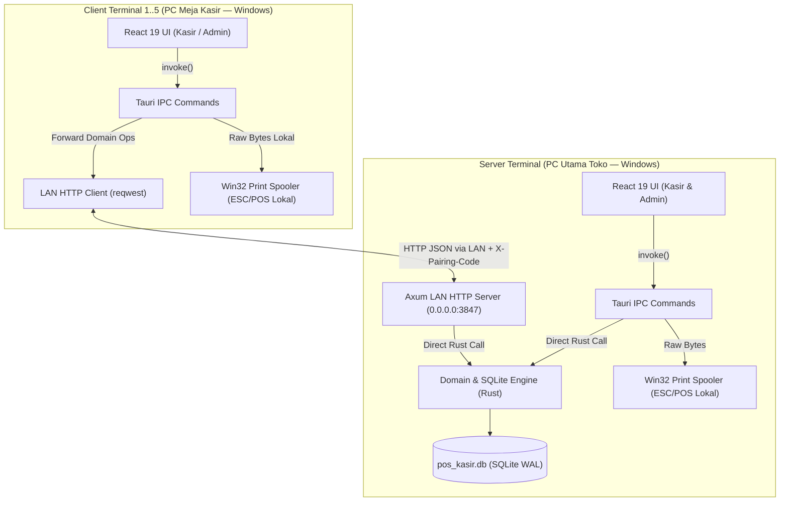
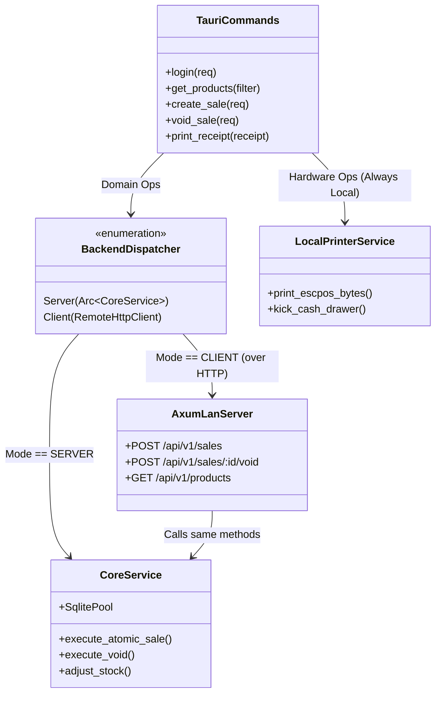

# Dokumen Arsitektur Sistem (ARCHITECTURE) — POS-Kasir

Dokumen ini menjelaskan arsitektur perangkat lunak, topologi jaringan lokal (LAN), batas modul (*deep module seams*), serta pemilihan teknologi untuk aplikasi **POS-Kasir** berbasis **Tauri 2 (Rust + React 19 + TypeScript)**.

Keputusan arsitektur utama merujuk pada:
- [ADR-0001: Arsitektur Dual-Mode (Server/Client LAN) dalam Satu Binary Tauri](file:///home/bimadev/project/antigravity/pos-kasir/docs/adr/0001-dual-mode-lan-server-sqlite.md)
- [ADR-0002: Pencetakan Struk menggunakan Raw ESC/POS via Windows Print Spooler](file:///home/bimadev/project/antigravity/pos-kasir/docs/adr/0002-raw-escpos-windows-spooler-printing.md)
- [ADR-0003: Pemotongan Stok Atomik saat Pembayaran Tanpa Reservasi pada Held Bill](file:///home/bimadev/project/antigravity/pos-kasir/docs/adr/0003-unreserved-held-bills-and-atomic-sale-stock.md)

---

## 1. Topologi Sistem & Jaringan Lokal (LAN)

Satu file installer `.exe` yang sama diinstal di seluruh komputer toko (1 **Server Terminal** + 3 s.d. 5 **Client Terminal**). Perbedaan perilaku ditentukan oleh konfigurasi lokal (`local_config.json`) pada masing-masing komputer:



### Prinsip Pemisahan Tanggung Jawab (Data vs Perangkat Keras)
1. **Operasi Data & Domain Bisnis (Terpusat di `Server Terminal`)**:
   - Autentikasi **User**, katalog **Product**, **Stock Adjustment**, pembuatan **Sale**, **Held Bill**, **Void**, dan **Laporan** selalu dieksekusi di atas database SQLite milik **Server Terminal**.
2. **Operasi Perangkat Keras & Konfigurasi Terminal (Lokal di Tiap PC)**:
   - Pencetakan **Receipt** (`print_receipt`), pemicu **Cash Drawer** (`kick_drawer`), pembacaan daftar printer Windows (`list_local_printers`), dan konfigurasi terminal (`local_config.json`) **selalu dieksekusi secara lokal** oleh proses Rust di komputer tempat kasir tersebut duduk.

---

## 2. Desain *Deep Module* & Abstraksi Transport di Rust

Agar kode frontend React dan backend Rust tidak terduplikasi antara mode **Server Terminal** dan **Client Terminal**, arsitektur ini menerapkan satu *seam* abstraksi di dalam `src-tauri`:

1. **Frontend React (`src/`) Tidak Peduli Mode Jaringan**:
   - Komponen React hanya memanggil fungsi `invoke(...)` Tauri (dibungkus dalam satu modul `src/services/ipc.ts`).
   - React tidak pernah melakukan `fetch()` langsung ke jaringan LAN; seluruh komunikasi jaringan ditangani oleh Rust di balik layar (menghindari masalah CORS WebView2 dan menyatukan penanganan error).
2. **Satu Implementasi Logika Bisnis (`CoreService` di Rust)**:
   - Seluruh aturan bisnis (validasi stok $\ge 0$, perhitungan **Product Discount**, transaksi atomik **Sale**, *snapshot* **Line Item**, dan **Void**) ditulis **satu kali saja** di dalam `CoreService` (yang mengakses SQLite).
   - Saat aplikasi berjalan sebagai **Server Terminal**:
     - Panggilan `invoke()` dari layar **Server Terminal** langsung memanggil metode `CoreService`.
     - Server HTTP `Axum` yang mendengarkan port LAN (`0.0.0.0:3847`) juga memanggil metode `CoreService` yang persis sama.
   - Saat aplikasi berjalan sebagai **Client Terminal**:
     - Panggilan `invoke()` dari layar **Client Terminal** diteruskan oleh `RemoteClientAdapter` (`reqwest`) ke endpoint HTTP `Axum` di **Server Terminal**, lalu mengembalikan respons tipe Rust yang identik ke frontend React.



---

## 3. Spesifikasi Tech Stack & Dependensi

### 3.1. Backend Rust ([src-tauri/Cargo.toml](file:///home/bimadev/project/antigravity/pos-kasir/src-tauri/Cargo.toml))
| Kategori | Crate | Kegunaan & Alasan Pemilihan |
| :--- | :--- | :--- |
| **Framework Desktop** | `tauri = { version = "2", features = ["tray-icon"] }` | Core runtime, IPC, dan fitur *Windows System Tray* untuk menjaga **Server Terminal** tetap hidup. |
| **Database Lokal** | `rusqlite = { version = "0.32", features = ["bundled"] }` + `r2d2` / `r2d2_sqlite` | Mengemas engine SQLite terbaru langsung di dalam `.exe` tanpa ketergantungan `.dll` eksternal di Windows. Mendukung penuh `BEGIN IMMEDIATE` untuk transaksi stok atomik. |
| **Async & LAN HTTP Server** | `tokio = { version = "1", features = ["full"] }`, `axum = "0.8"`, `tower-http = "0.6"` | Menjalankan server HTTP lokal di **Server Terminal** untuk melayani 3–5 **Client Terminal** dengan konkurensi tinggi dan jejak memori minimal. |
| **LAN HTTP Client** | `reqwest = { version = "0.12", features = ["json", "rustls-tls"] }` | Digunakan oleh **Client Terminal** untuk memanggil API **Server Terminal** melalui LAN dengan *connection pooling* dan *timeout* terukur. |
| **Keamanan & Hash** | `argon2 = "0.5"`, `rand = "0.8"` | Hashing `Password` dan `PIN Admin`, pembuatan token sesi, serta pembuatan **Pairing Code**. |
| **CSV Import/Export** | `csv = "1.3"` | Parsing dan pembuatan file CSV katalog **Product** serta ekspor laporan penjualan. |
| **Waktu & ID** | `chrono = { version = "0.4", features = ["serde"] }`, `uuid = { version = "1", features = ["v4", "serde"] }` | Penanganan zona waktu lokal toko untuk nomor struk harian dan batas waktu **Void** di hari yang sama. |
| **Printer Windows** | `windows-sys = { version = "0.59", features = ["Win32_Graphics_Printing", "Win32_Foundation"] }` | Mengirimkan byte Raw ESC/POS langsung ke *Windows Print Spooler* (`OpenPrinterW`, `StartDocPrinterW`, `WritePrinter`) tanpa dialog cetak browser. |

### 3.2. Frontend ([package.json](file:///home/bimadev/project/antigravity/pos-kasir/package.json))
| Kategori | Paket | Kegunaan |
| :--- | :--- | :--- |
| **UI Framework** | `react ^19.1.0`, `react-dom ^19.1.0`, `typescript ~6.0.3` | Sudah terpasang di repositori. |
| **Tauri Bridge** | `@tauri-apps/api ^2`, `@tauri-apps/plugin-dialog` (untuk pilih file CSV/Backup) | Komunikasi IPC ke backend Rust dan dialog pemilihan file asli Windows. |
| **Styling & Ikon** | `tailwindcss` (atau CSS modular bersih) + `lucide-react` | Antarmuka kasir dengan kontras tinggi, keterbacaan angka jelas, dan tata letak responsif layar desktop kasir (1366×768 hingga 1920×1080). |
| **Testing** | `vitest`, `@testing-library/react` | Pengujian unit dan integrasi komponen frontend serta kalkulator keranjang/kembalian. |

---

## 4. Struktur Direktori Proyek

```text
pos-kasir/
├── GLOSSARY.md                          # Kamus bahasa baku domain (Single Source of Truth istilah)
├── AGENTS.md                            # Instruksi & context pointers untuk AI Agent
├── docs/
│   ├── PRD.md                           # Visi produk, peran pengguna, alur utama, & batasan scope
│   ├── REQUIREMENTS.md                  # Kebutuhan fungsional (FR), rumus bisnis (BR), & NFR
│   ├── ARCHITECTURE.md                  # Topologi sistem, deep modules, & struktur direktori
│   ├── SYSTEM-DESIGN.md                 # Skema SQLite DDL, kontrak IPC/HTTP API, & protokol ESC/POS
│   ├── UI-UX-SPEC.md                    # Tata letak layar, shortcut keyboard kasir, & scanner HID
│   ├── CONTEXT.md                       # Panduan kerja AI Agent, invarian domain, & roadmap fase
│   └── adr/                             # Architecture Decision Records
│       ├── 0001-dual-mode-lan-server-sqlite.md
│       ├── 0002-raw-escpos-windows-spooler-printing.md
│       └── 0003-unreserved-held-bills-and-atomic-sale-stock.md
├── src-tauri/
│   ├── Cargo.toml
│   └── src/
│       ├── main.rs                      # Entry point Windows binary
│       ├── lib.rs                       # Setup Tauri Builder, System Tray, & registrasi commands
│       ├── config.rs                    # Baca/tulis local_config.json (%APPDATA%)
│       ├── error.rs                     # Tipe AppError terpadu (serializable ke Frontend & HTTP)
│       ├── models/                      # Struct domain (User, Product, Sale, LineItem, HeldBill, Report)
│       ├── db/
│       │   ├── mod.rs                   # Koneksi SQLite (WAL mode, busy_timeout, migrasi DDL)
│       │   └── schema.sql               # Skema tabel SQLite lengkap
│       ├── services/
│       │   ├── core_service.rs          # Seluruh logika bisnis & transaksi SQLite atomik
│       │   ├── dispatcher.rs            # Pemilih otomatis: Server (CoreService) vs Client (Reqwest)
│       │   ├── auth_service.rs          # Verifikasi Argon2 password, PIN Admin, & session token
│       │   └── csv_service.rs           # Import & export CSV produk/laporan
│       ├── lan/
│       │   ├── server.rs                # Axum HTTP Server (hanya jalan di Server Terminal)
│       │   ├── client.rs                # Reqwest HTTP Client (hanya jalan di Client Terminal)
│       │   └── middleware.rs            # Validasi header X-Pairing-Code & X-Session-Token
│       ├── hardware/
│       │   ├── escpos.rs                # Generator byte Raw ESC/POS (58mm / 80mm & Cash Drawer kick)
│       │   └── spooler.rs               # Integrasi Win32 Print Spooler ( + mock/fallback non-Windows)
│       └── commands/                    # Handler #[tauri::command] yang dipanggil oleh React
└── src/
    ├── main.tsx
    ├── App.tsx                          # Guard routing: SetupWizard -> Login -> POS / Admin Layout
    ├── types/
    │   └── domain.ts                    # Kontrak TypeScript yang identik dengan struct Rust
    ├── services/
    │   └── ipc.ts                       # Wrapper bertipe kuat untuk seluruh panggilan invoke()
    ├── context/
    │   ├── AuthContext.tsx              # State sesi User aktif (Admin / Cashier)
    │   └── TerminalContext.tsx          # Status koneksi LAN, mode terminal, & pratinjau struk
    ├── hooks/
    │   ├── useBarcodeScanner.ts         # Detektor input cepat USB Barcode Scanner (HID Keyboard Wedge)
    │   └── usePosShortcuts.ts           # Listener tombol F1-F10, Enter, Delete, Esc di layar kasir
    ├── pages/
    │   ├── SetupWizardPage.tsx          # Layar konfigurasi awal (Server vs Client Terminal)
    │   ├── LoginPage.tsx                # Layar masuk kasir/admin
    │   ├── PosRegisterPage.tsx          # Layar utama kasir + modal bayar tunai, Held Bill, & riwayat hari ini
    │   ├── ProductsPage.tsx             # Kelola katalog Product + Import/Export CSV (Admin)
    │   ├── StockAdjustmentPage.tsx      # Form & riwayat stok masuk / koreksi stok (Admin)
    │   ├── ReportsPage.tsx              # Laporan omzet, HPP, laba kotor, & produk terlaris (Admin)
    │   ├── UsersPage.tsx                # Kelola akun Cashier & Admin beserta PIN (Admin)
    │   └── SettingsPage.tsx             # Pengaturan Printer lokal, Toko, Pairing Code, & Backup DB
    └── components/
        ├── layout/                      # TopBar (indikator LAN, jam, user), AdminSidebar
        ├── pos/                         # CartTable, PaymentModal, HeldBillsModal, TodaySalesDrawer, VoidPinModal
        └── receipt/                     # ReceiptPreviewModal (visualisasi struk thermal di layar)
```

---

## 5. Penanganan Perilaku Khusus Windows

1. **Penyimpanan Data Lokal (`%APPDATA%`)**:
   - Konfigurasi terminal disimpan di `%APPDATA%\com.pos-kasir.app\local_config.json`.
   - Pada **Server Terminal**, file database utama disimpan di `%APPDATA%\com.pos-kasir.app\pos_kasir.db` (beserta file `-wal` dan `-shm`).
2. **Windows Firewall pada `Server Terminal`**:
   - Ketika **Server Terminal** mengikat (*bind*) port `0.0.0.0:3847`, Windows Firewall akan meminta izin akses jaringan lokal pada saat pertama kali dijalankan. Halaman Pengaturan Server menampilkan daftar IP LAN lokal komputer (misal `192.168.1.x:3847`) untuk memudahkan pengisian di **Client Terminal**.
3. **Intersepsi Tombol Close (`X`) & System Tray**:
   - Pada `lib.rs`, event `tauri::WindowEvent::CloseRequested` diintersepsi: jika terminal berstatus `SERVER`, `api.prevent_close()` dipanggil dan jendela disembunyikan (`window.hide()`), sementara ikon di *Windows System Tray* menyediakan menu **"Buka POS-Kasir"** dan **"Matikan Server & Keluar"**.
4. **Kompilasi Lintas Platform saat Pengembangan (Linux/macOS vs Windows)**:
   - Modul `src-tauri/src/hardware/spooler.rs` wajib menggunakan atribut kondisional `#[cfg(target_os = "windows")]` untuk pemanggilan Win32 API `OpenPrinterW`/`WritePrinter`, dan menyediakan implementasi *stub/simulator* pada `#[cfg(not(target_os = "windows"))]` agar kode Rust tetap dapat dikompilasi dan diuji (`cargo test`) di lingkungan pengembangan Linux maupun Windows.
