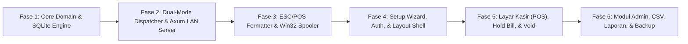

# Panduan Konteks & Peta Jalan Implementasi AI Agent (CONTEXT) — POS-Kasir

Dokumen ini adalah titik orientasi utama bagi AI Agent sebelum dan selama menulis kode untuk **POS-Kasir**. Ikuti seluruh aturan invarian, konvensi kode, dan urutan fase di dokumen ini agar implementasi bebas dari regresi maupun salah tafsir kebutuhan.

---

## 1. Indeks Dokumen SDD (Single Source of Truth)

Sebelum mengubah atau menambah fitur, baca dokumen yang relevan:
1. **[GLOSSARY.md](file:///home/bimadev/project/antigravity/pos-kasir/GLOSSARY.md)**: Kosakata baku domain (`User`, `Cashier`, `Admin`, `Stock Keeper`, `Reporter`, `Product`, `Cost Price`, `Selling Price`, `Product Discount`, `Stock Adjustment`, `Sale`, `Line Item`, `Held Bill`, `Void`, `Receipt`, `Server Terminal`, `Client Terminal`, `Pairing Code`, `Cash Drawer`). Gunakan istilah ini secara konsisten di nama struct Rust, interface TypeScript, dan tabel database.
2. **[docs/PRD.md](file:///home/bimadev/project/antigravity/pos-kasir/docs/PRD.md)**: Visi produk, alur perjalanan pengguna, dan batasan fitur (*In-Scope vs Out-of-Scope*).
3. **[docs/REQUIREMENTS.md](file:///home/bimadev/project/antigravity/pos-kasir/docs/REQUIREMENTS.md)**: Rumus matematika bisnis (`BR-01` s.d. `BR-03`) dan daftar kriteria penerimaan (`FR-*`, `NFR-*`).
4. **[docs/ARCHITECTURE.md](file:///home/bimadev/project/antigravity/pos-kasir/docs/ARCHITECTURE.md)**: Topologi Dual-Mode (`SERVER` vs `CLIENT`), abstraksi `BackendDispatcher`, dan daftar crate Rust / paket NPM.
5. **[docs/SYSTEM-DESIGN.md](file:///home/bimadev/project/antigravity/pos-kasir/docs/SYSTEM-DESIGN.md)**: Skema DDL SQLite (`schema.sql`), kontrak `local_config.json`, daftar Tauri Commands & HTTP Endpoints, algoritma transaksi atomik, dan byte **Raw ESC/POS**.
6. **[docs/UI-UX-SPEC.md](file:///home/bimadev/project/antigravity/pos-kasir/docs/UI-UX-SPEC.md)**: Tata letak layar, pintasan keyboard (`F1`–`F10`), dan algoritma deteksi *USB Barcode Scanner*.
7. **[docs/adr/](file:///home/bimadev/project/antigravity/pos-kasir/docs/adr/)**: Keputusan arsitektur yang mengikat ([ADR-0001](file:///home/bimadev/project/antigravity/pos-kasir/docs/adr/0001-dual-mode-lan-server-sqlite.md), [ADR-0002](file:///home/bimadev/project/antigravity/pos-kasir/docs/adr/0002-raw-escpos-windows-spooler-printing.md), [ADR-0003](file:///home/bimadev/project/antigravity/pos-kasir/docs/adr/0003-unreserved-held-bills-and-atomic-sale-stock.md), [ADR-0004](file:///home/bimadev/project/antigravity/pos-kasir/docs/adr/0004-four-discrete-user-roles-and-approval-thresholds.md)).

---

## 2. Tiga Belas Invarian Mutlak (Guardrails untuk AI Agent)

Saat mengimplementasikan fitur, pastikan ke-13 invarian berikut selalu terpenuhi:

1. **Rupiah & Kuantitas Bulat (`i64`)**: Seluruh harga (`cost_price`, `selling_price`, `discount_value`, `subtotal`, `total_amount`, `cash_received`, `change_amount`) dan jumlah stok/kuantitas (`stock`, `quantity`) menggunakan bilangan bulat (`i64` di Rust, `number` bulat di TypeScript). Pembagian persentase diskon wajib menggunakan pembulatan ke bawah integer (`(price * pct) / 100`).
2. **Blokir Keras Stok `0` (`stock >= 0`)**: Barang dengan `stock == 0` atau permintaan kuantitas $> \text{stock}$ wajib ditolak baik di antarmuka kasir maupun di dalam transaksi `BEGIN IMMEDIATE` SQLite saat pembuatan **Sale**.
3. **`Held Bill` Tidak Mengunci Stok**: Menyimpan **Held Bill** hanya menyimpan daftar `product_id` dan `quantity` di tabel `held_bills`/`held_bill_items` pada **Server Terminal** tanpa memotong `products.stock`. Validasi stok dilakukan ulang saat dipanggil kembali dan saat dibayar.
4. **Snapshot Harga Abadi di `sale_line_items`**: Laporan omzet, HPP, dan laba kotor wajib dihitung dari kolom `*_snapshot` pada `sale_line_items`, bukan dengan melakukan `JOIN` ke harga terkini di tabel `products`.
5. **Hanya Pembayaran Tunai (`Cash`)**: Jangan menambahkan pilihan metode pembayaran non-tunai, piutang/kasbon, atau pajak PPN terpisah.
6. **Diskon Terpusat oleh `Admin`**: **Cashier** tidak memiliki input untuk mengubah harga jual atau mengetik diskon manual di layar kasir; diskon otomatis dihitung dari **Product Discount** yang disetel **Admin** pada master **Product**.
7. **`Void` Khusus Hari yang Sama dengan PIN `Admin`**: Hanya transaksi **Sale** berstatus `COMPLETED` dengan `transaction_date == tanggal_hari_ini_lokal` yang dapat di-**Void**, wajib menyertakan alasan (`void_reason`) dan verifikasi `admin_pin` terhadap hash PIN milik salah satu pengguna `ADMIN` aktif.
8. **Satu Logika Bisnis di `CoreService`**: Jangan menduplikasi query SQL atau perhitungan bisnis di dua tempat. Baik panggilan lokal di **Server Terminal** maupun endpoint HTTP `Axum` untuk **Client Terminal** harus memanggil metode `CoreService` yang sama.
9. **Eksekusi Perangkat Keras Selalu Lokal**: Pencetakan struk (`print_receipt`) dan pembukaan laci uang (`kick_drawer`) selalu dijalankan di komputer tempat kasir menekan tombol Bayar, bukan dikirim untuk dicetak di printer milik **Server Terminal**.
10. **Perlindungan Jendela `Server Terminal`**: Menekan tombol Close (`X`) pada jendela **Server Terminal** wajib meminimalkan aplikasi ke *Windows System Tray* agar koneksi LAN ke 3–5 **Client Terminal** tidak terputus.
11. **Pemisahan Peran Tegas Kasir vs Back-Office**: Hanya pengguna `ADMIN` dan `CASHIER` yang diizinkan mengakses layar kasir (POS), menahan/memanggil `Held Bill`, dan membuka shift kasir. Pengguna `STOCK` (Petugas Stok) dan `REPORTER` (Petugas Laporan) murni back-office dan diblokir dari seluruh aksi transaksi kasir.
12. **Ambang Batas Persetujuan Stok & Audit Log**: Penyesuaian stok atau stock opname oleh pengguna `STOCK` dengan nilai $\ge \text{Rp } 100.000$ ATAU selisih $\ge 10\%$ dari stok sistem wajib berstatus `PENDING` dan memerlukan persetujuan PIN `ADMIN` sebelum stok fisik di database diperbarui. Seluruh perubahan stok terekam pada audit log.
13. **Kerahasiaan Harga Modal Kasir**: `cost_price` hanya boleh diekspos kepada peran `ADMIN`, `STOCK` (saat input penerimaan barang), dan `REPORTER` (agregasi laporan laba). Peran `CASHIER` tidak boleh menerima nilai `cost_price` sama sekali.

---

## 3. Strategi Pengujian (Test-Driven Development)

Setiap fase implementasi wajib disertai pengujian otomatis yang dapat dijalankan melalui `cargo test` (di `src-tauri/`) dan `pnpm test` (di `src/`):

### 3.1. Pengujian Backend Rust (`cargo test`)
- **Unit Test Kalkulator Domain**: Menguji `BR-01` dan `BR-02` (diskon `NONE`, `NOMINAL`, `PERCENT`, pembulatan integer, subtotal, kembalian, dan laba kotor).
- **Integration Test SQLite In-Memory / Tempfile**:
  - Menguji pembuatan **Sale** sukses memotong `products.stock` dan menyimpan *snapshot* **Line Item**.
  - Menguji penolakan **Sale** ketika `quantity > stock` (dan memastikan tidak ada perubahan stok parsial / *atomic rollback*).
  - Menguji skenario perubahan `cost_price` dan `selling_price` produk setelah **Sale** selesai tidak mengubah hasil `get_sales_report` untuk transaksi sebelumnya.
  - Menguji alur **Void** dengan PIN **Admin** valid (stok kembali bertambah, status menjadi `VOIDED`, transaksi keluar dari omzet bersih) serta penolakan **Void** jika PIN salah atau tanggal transaksi berbeda.
- **Unit Test Formatter ESC/POS**: Memastikan barisan byte `Vec<u8>` untuk lebar 58mm (32 karakter) dan 80mm (48 karakter) rapi, menyertakan label `"*** CETAKAN ULANG ***"` saat `is_reprint == true`, dan hanya menyertakan byte *kick drawer* (`1B 70 00 19 FA`) saat `open_drawer == true`.
- **Integration Test LAN Client-Server**: Menjalankan instance `Axum` di port *ephemeral* lokal (`127.0.0.1:0`) dan menguji `RemoteHttpClient` melakukan login, mengambil produk, menahan **Held Bill**, dan membuat **Sale** lengkap dengan validasi header `X-Pairing-Code`.

### 3.2. Pengujian Frontend TypeScript (`vitest`)
- Menguji kalkulasi keranjang belanja, validasi stok maksimum di UI, dan deteksi input cepat *Barcode Scanner* (`useBarcodeScanner`).

---

## 4. Peta Jalan Implementasi Bertahap (Implementation Roadmap)

Kerjakan proyek secara berurutan per fase. Setiap fase harus lulus kompilasi (`cargo check`, `pnpm build`) dan pengujian (`cargo test`) sebelum lanjut ke fase berikutnya:

### Fase 1: Fondasi Domain, Konfigurasi Lokal, & Database SQLite (`src-tauri`)
- Tambahkan dependensi di `src-tauri/Cargo.toml`.
- Implementasikan `config.rs` (`local_config.json`), `models/`, dan `db/schema.sql`.
- Implementasikan `CoreService` lengkap dengan autentikasi Argon2, CRUD `Product`, `Stock Adjustment`, algoritma atomik `create_sale`, `void_sale`, `Held Bill`, dan query `SalesReport`.
- **Kriteria Selesai Fase 1**: Seluruh *unit & integration test* `CoreService` di SQLite lulus `cargo test`.

### Fase 2: Arsitektur Dual-Mode (`BackendDispatcher` + `Axum` LAN Server + System Tray)
- Implementasikan `lan/server.rs` (router HTTP `Axum` + middleware validasi `X-Pairing-Code` & `X-Session-Token`) dan `lan/client.rs` (`reqwest`).
- Implementasikan `services/dispatcher.rs` yang mengarahkan panggilan ke `CoreService` lokal (jika mode `SERVER`) atau ke `RemoteHttpClient` (jika mode `CLIENT`).
- Konfigurasikan *Windows System Tray* dan intersepsi event `CloseRequested` di `lib.rs` untuk mode `SERVER`.
- **Kriteria Selesai Fase 2**: Test integrasi *round-trip* HTTP Client $\leftrightarrow$ Axum Server lulus `cargo test`.

### Fase 3: Mesin Cetak `Raw ESC/POS`, `Win32 Print Spooler`, & `CSV Service`
- Implementasikan `hardware/escpos.rs` untuk merakit struk 58mm/80mm dan komando pembuka **Cash Drawer**.
- Implementasikan `hardware/spooler.rs` menggunakan Win32 API di Windows (`#[cfg(target_os = "windows")]`) dan *simulator/stub* di OS non-Windows.
- Implementasikan `services/csv_service.rs` untuk Import/Export CSV **Product** dan Export CSV Laporan, serta fungsi Backup/Restore SQLite (`VACUUM INTO`).
- Ekspos seluruh fungsi sebagai `#[tauri::command]` di `commands/`.
- **Kriteria Selesai Fase 3**: Seluruh Tauri command terdaftar di `lib.rs` dan test formatter ESC/POS serta CSV lulus `cargo test`.

### Fase 4: Frontend Shell, Setup Wizard Pertama Kali, & Autentikasi (`src/`)
- Buat kontrak tipe `src/types/domain.ts` dan klien IPC `src/services/ipc.ts`.
- Bangun `SetupWizardPage.tsx` (pilihan **Server Terminal** vs **Client Terminal** beserta tombol *Uji Koneksi*).
- Bangun `LoginPage.tsx`, `TopBar.tsx` (dengan indikator status LAN *real-time* & informasi terminal), serta navigasi berbasis peran (**Cashier** vs **Admin**).
- **Kriteria Selesai Fase 4**: Alur *First-Run Setup* dan *Login* berfungsi penuh serta lulus `pnpm build`.

### Fase 5: Layar Kasir Utama (`PosRegisterPage`), `Held Bill`, `Reprint`, & `Void`
- Implementasikan `useBarcodeScanner.ts` dan `usePosShortcuts.ts` (`F1`–`F10`, `Delete`, `Enter`, `Esc`).
- Bangun `PosRegisterPage.tsx`, `CartTable.tsx` (dengan blokir keras jika `stock == 0` + audio beep peringatan), `PaymentModal.tsx` (pecahan uang cepat & hitung kembalian), `HeldBillsModal.tsx`, `TodaySalesDrawer.tsx`, `VoidPinModal.tsx`, dan `ReceiptPreviewModal.tsx`.
- **Kriteria Selesai Fase 5**: Seluruh alur transaksi kasir, tahan/panggil pesanan lintas terminal, cetak struk/pratinjau layar, dan **Void** dengan PIN **Admin** berjalan mulus.

### Fase 6: Halaman Manajemen `Admin` (Produk, CSV, Stok, Laporan, User, & Pengaturan)
- Bangun `ProductsPage.tsx` (CRUD produk, scan barcode di form, Import/Export CSV).
- Bangun `StockAdjustmentPage.tsx` (form stok masuk/rusak/koreksi & tabel audit log).
- Bangun `ReportsPage.tsx` (KPI omzet bersih, HPP, laba kotor, produk terlaris, stok menipis, & ekspor CSV).
- Bangun `UsersPage.tsx` (kelola akun **Cashier** & **Admin** beserta reset password/PIN).
- Bangun `SettingsPage.tsx` (pengaturan printer lokal + test print/laci, identitas toko, **Pairing Code** LAN, serta Backup/Restore database).
- **Kriteria Selesai Fase 6**: Seluruh fitur `FR-*` terverifikasi, `cargo test` dan `pnpm build` bersih tanpa *warning/error*.
