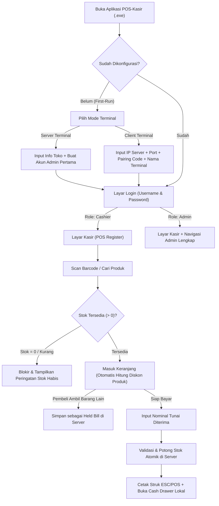

# Product Requirements Document (PRD) — POS-Kasir

| Metadata | Detail |
| :--- | :--- |
| **Nama Produk** | POS-Kasir |
| **Tipe Aplikasi** | Aplikasi Desktop Point-of-Sale (POS) Ritel / Minimarket |
| **Platform Target** | Windows 10 / Windows 11 (64-bit) |
| **Teknologi Utama** | Tauri 2 (Rust Backend) + React 19 + TypeScript + Vite + SQLite |
| **Skala Deployment** | 1 **Server Terminal** (Server + Kasir) & 3–5 **Client Terminal** (Kasir) dalam 1 jaringan LAN toko |
| **Status Dokumen** | Baseline SDD (Spec-Driven Development) — Siap Implementasi |

---

## 1. Ringkasan Eksekutif & Visi Produk

**POS-Kasir** adalah aplikasi kasir desktop ringan, cepat, dan andal yang dirancang khusus untuk operasional toko ritel dan minimarket dengan banyak meja kasir di satu lokasi fisik.

Aplikasi ini dikemas sebagai **satu installer `.exe` Windows** yang dapat beroperasi dalam dua mode:
1. **Server Terminal**: Komputer utama di toko yang menyimpan seluruh data terpusat di SQLite lokal, membuka layanan jaringan lokal (LAN) untuk terminal lain, serta sekaligus digunakan sebagai meja kasir dan administrasi.
2. **Client Terminal**: 3 hingga 5 komputer kasir pendamping yang terhubung melalui jaringan lokal (LAN/Wi-Fi toko) ke **Server Terminal** untuk melakukan transaksi penjualan secara *real-time* tanpa risiko bentrok stok.

Fokus utama produk ini adalah **kecepatan layanan di meja kasir** (mendukung *Barcode Scanner USB*, *Thermal Receipt Printer* 58mm/80mm, *Cash Drawer RJ11*, dan navigasi *full keyboard*), **ketepatan stok barang satuan bulat** (blokir otomatis jika stok `0`), serta **kemudahan pengelolaan toko oleh Admin**.

---

## 2. Latar Belakang Masalah & Tujuan Bisnis

### Masalah yang Diselesaikan
1. **Sinkronisasi Stok Antar Meja Kasir**: Dengan 4–6 meja kasir aktif (1 Server + 3–5 Client), pencatatan manual atau database terpisah rawan menyebabkan stok minus atau selisih ketika barang terakhir dibeli bersamaan di dua meja kasir.
2. **Kerumitan Instalasi Server di Toko**: Pemilik toko tidak ingin menginstal dan merawat database server terpisah (seperti PostgreSQL/MySQL/Docker). Mereka membutuhkan satu aplikasi Windows yang langsung berfungsi begitu diinstal.
3. **Kecepatan Antrean Minimarket**: Kasir membutuhkan antarmuka yang merespons pemindaian *barcode* secara instan, menghitung kembalian tunai tanpa jeda, langsung mencetak struk tanpa *popup print dialog* Windows, dan langsung membuka laci uang otomatis.
4. **Kontrol Kecurangan Kasir**: Pemilik toko perlu memastikan kasir tidak bisa memberikan diskon sembarangan, tidak bisa menjual barang yang stok sistemnya `0` tanpa pencatatan barang masuk, dan tidak bisa membatalkan struk lunas (**Void**) tanpa sepengetahuan **Admin**.

### Tujuan Produk (Product Goals)
- **Zero-Friction Checkout**: Waktu dari scan barcode hingga barang masuk keranjang $< 50\text{ ms}$; pencetakan struk dan pembukaan **Cash Drawer** $< 1\text{ detik}$ setelah pembayaran dikonfirmasi.
- **Akurasi Inventaris 100%**: Stok selalu bulat ($\ge 0$), divalidasi secara atomik saat pembayaran (**Sale**), dan setiap perubahan stok di luar penjualan tercatat di riwayat **Stock Adjustment**.
- **Laporan Laba Akurat**: Perubahan harga beli (**Cost Price**) atau harga jual (**Selling Price**) di kemudian hari tidak pernah mengubah perhitungan laba kotor pada transaksi masa lalu.

---

## 3. Profil Pengguna & Peran (`User` Roles)

Sistem memiliki **4 peran pengguna diskret** sesuai [GLOSSARY.md](file:///home/bimadev/project/antigravity/pos-kasir/GLOSSARY.md) dan [ADR-0004](file:///home/bimadev/project/antigravity/pos-kasir/docs/adr/0004-four-discrete-user-roles-and-approval-thresholds.md):

### 3.1. `Cashier` (Kasir)
- **Profil**: Staf operator meja kasir yang melayani antrean pembeli.
- **Kredensial**: `Username` dan `Password`.
- **Hak Akses**:
  - Mengakses **Layar Kasir (POS Register)** untuk memindai/mencari **Product**, mengubah kuantitas bulat, dan memproses pembayaran tunai (**Sale**).
  - Menangguhkan keranjang belanja (**Held Bill**) dan memanggil kembali **Held Bill** dari meja kasir mana pun.
  - Membuka dan menutup **Shift Kasir** serta mencatat modal awal dan kas masuk/keluar operasional.
  - Melihat **Riwayat Transaksi Hari Ini** dan melakukan cetak ulang struk (**Reprint** dengan penanda `"CETAKAN ULANG"`).
  - Mengajukan pembatalan transaksi (**Void**) pada transaksi hari ini dengan meminta **Admin** memasukkan PIN otorisasi di layar kasir.
  - Mengatur konfigurasi printer lokal di komputernya (pilih printer & test print).
- **Pembatasan**:
  - Tidak dapat melihat **Cost Price** (harga modal) atau laba kotor.
  - Tidak dapat menambah/mengubah produk, harga, diskon, maupun stok.
  - Tidak dapat memberikan diskon manual di luar **Product Discount** yang telah ditetapkan **Admin**.
  - Tidak dapat mengakses laporan berkala atau manajemen pengguna.

### 3.2. `Admin` (Pengelola / Pemilik Toko)
- **Profil**: Pemilik toko atau kepala toko yang mengelola inventaris, harga, staf kasir, dan keuangan, serta sewaktu-waktu ikut melayani antrean pembeli sebagai kasir.
- **Kredensial**: `Username`, `Password`, dan **PIN 4–6 digit** (digunakan untuk otorisasi cepat seperti **Void** dan persetujuan stok).
- **Hak Akses**:
  - Memiliki **seluruh hak akses `Cashier`** (dapat berpindah ke **Layar Kasir (POS)** hanya dengan 1 klik tanpa ganti akun).
  - Mengelola katalog **Product** (Tambah, Edit, Nonaktifkan/*Soft Delete*, atur **Cost Price**, **Selling Price**, **Product Discount**, **Price Tiers**, serta **Import/Export Excel**).
  - Mencatat **Stock Adjustment** (stok masuk, rusak, hilang, koreksi, dan stock opname massal).
  - Mengotorisasi persetujuan penyesuaian stok yang diajukan oleh **Stock Keeper** melebihi batas ambang.
  - Mengotorisasi atau melakukan **Void** transaksi berjalan di hari yang sama.
  - Melihat seluruh laporan (**Penjualan**, **Shift**, **Keuangan/Arus Kas**, **Laba Kotor**, dan **Inventaris Stok**).
  - Mengelola akun **User** (tambah/edit/nonaktifkan 4 peran pengguna, reset password/PIN).
  - Mengelola **Pengaturan Toko & Server** (identitas toko, ambang batas persetujuan stok, **Pairing Code** LAN, serta **Backup & Restore Database**).

### 3.3. `Stock Keeper` (Petugas Stok)
- **Profil**: Staf gudang atau penanggung jawab inventaris barang fisik yang murni bekerja di back-office.
- **Kredensial**: `Username` dan `Password`.
- **Hak Akses**:
  - Mengakses modul **Katalog Produk**: melihat daftar produk, menambah produk baru, mengedit nama/barcode/kategori/satuan, dan mengisi/melihat harga modal (**Cost Price**).
  - Mengakses modul **Penyesuaian Stok**: mencatat penerimaan barang masuk (*Restock*), koreksi stok fisik, dan sesi *Stock Opname*.
  - Melihat laporan persediaan dan mutasi stok barang (*Stock Report*).
  - Mengatur konfigurasi printer lokal di komputernya.
- **Pembatasan**:
  - **Dilarang mengakses Layar Kasir (POS)**, tidak bisa bertransaksi kasir, dan tidak membuka shift kasir.
  - Dilarang menetapkan atau mengubah harga jual (**Selling Price**), diskon produk (**Product Discount**), maupun harga grosir (**Price Tiers**).
  - Penyesuaian stok atau selisih opname yang melampaui batas ambang ($\ge \text{Rp } 100.000$ ATAU $\ge 10\%$) berstatus `PENDING` dan wajib disetujui **Admin** dengan PIN sebelum stok fisik berubah.
  - Dilarang mengakses laporan laba kotor, laporan keuangan/arus kas, manajemen pengguna, dan pengaturan sistem.

### 3.4. `Reporter` (Petugas Laporan)
- **Profil**: Staf akunting internal, auditor toko, atau analis pembukuan yang meninjau kinerja keuangan toko secara read-only.
- **Kredensial**: `Username` dan `Password`.
- **Hak Akses**:
  - Melihat seluruh laporan toko: **Laporan Penjualan**, **Laporan Shift Kasir**, **Laporan Keuangan/Arus Kas**, **Laporan Laba Kotor**, dan **Laporan Inventaris Stok**.
  - Melihat **Cost Price** dan laba kotor secara agregat untuk kebutuhan kalkulasi margin laba.
  - Mengekspor laporan ke format Excel (`.xlsx`) dan menyimpannya secara manual ke folder lokal/jaringan.
  - Mencetak laporan ke format A4/PDF (dialog cetak Windows) dan mencetak ringkasan harian ke printer thermal 58mm/80mm.
  - Mengatur konfigurasi printer lokal di komputernya.
- **Pembatasan**:
  - **Dilarang mengakses Layar Kasir (POS)** dan tidak membuka shift kasir.
  - **Murni Read-Only**: tidak dapat menambah/mengedit produk, tidak dapat mengubah stok, tidak dapat membatalkan transaksi (**Void**), dan tidak dapat mengelola pengguna atau pengaturan toko.

| Hak Akses / Kemampuan | `ADMIN` | `CASHIER` | `STOCK` | `REPORTER` |
|---|:---:|:---:|:---:|:---:|
| Layar Kasir (POS) & Buka Shift | ✅ | ✅ | ❌ | ❌ |
| Tahan / Panggil `Held Bill` | ✅ | ✅ | ❌ | ❌ |
| Pengajuan Void (PIN Admin) | ✅ (Langsung) | ✅ (Ajukan PIN) | ❌ | ❌ |
| Master Produk (Nama, Barcode, Kategori) | ✅ | ❌ | ✅ | ❌ |
| Atur Harga Jual, Diskon, & Grosir | ✅ | ❌ | ❌ | ❌ |
| Lihat & Isi Harga Modal (`Cost Price`) | ✅ | ❌ | ✅ | ✅ (Read-only) |
| Restock & Koreksi Stok Fisik | ✅ (Langsung) | ❌ | ✅ (Ambang $\rightarrow$ PIN) | ❌ |
| Sesi Stock Opname Massal | ✅ | ❌ | ✅ (Ambang $\rightarrow$ PIN) | ❌ |
| Setujui Penyesuaian Stok Tertunda | ✅ (PIN) | ❌ | ❌ | ❌ |
| Laporan Transaksi & Shift | ✅ | Transaksi Hari Ini | ❌ | ✅ |
| Laporan Keuangan, Laba, & Nilai Stok | ✅ | ❌ | Stok saja | ✅ |
| Ekspor Excel & Cetak Dokumen A4 / Thermal | ✅ | Struk Staf | ❌ | ✅ |
| Manajemen User & Pengaturan Toko | ✅ | ❌ | ❌ | ❌ |

---

## 4. Alur Perjalanan Pengguna Utama (Core User Journeys)

### 4.1. Alur 1: Instalasi & Setup Pertama Kali (*First-Run Onboarding*)
1. Pengguna menginstal aplikasi `.exe` di komputer utama toko, membukanya, lalu memilih **"Komputer Server Utama (Server + Kasir)"**.
2. Pengguna mengisi `Nama Toko`, `Alamat`, `No. Telepon`, serta membuat akun **Admin Pertama** (`Username`, `Password`, `PIN 6 digit`).
3. Sistem menginisialisasi database SQLite, menghasilkan **Pairing Code**, dan menyalakan server LAN.
4. Pada 3–5 komputer kasir lainnya, pengguna menginstal file `.exe` yang sama, memilih **"Komputer Kasir Pendamping (Client)"**, memasukkan `IP Server`, `Port`, `Pairing Code`, dan `Nama Terminal` (misal `"Kasir 1"` s.d. `"Kasir 5"`), menekan **Test Connection**, lalu menyimpan.

### 4.2. Alur 2: Transaksi Kasir Cepat (*Fast Retail Checkout*)
1. **Cashier** berada di layar POS. Fokus kursor selalu siap menerima input *Barcode Scanner*.
2. Saat barang di-scan:
   - Jika produk ditemukan dan `Stok >= Kuantitas di Keranjang + 1`, barang langsung masuk daftar belanja (**Line Item**) beserta potongan **Product Discount** otomatis (jika ada).
   - Jika `Stok == 0` atau penambahan melebihi sisa stok, terdengar bunyi peringatan (*beep error*) dan muncul notifikasi bahwa stok barang habis (**tidak bisa masuk keranjang**).
3. Pembeli menyerahkan uang tunai. **Cashier** menekan `F8` (Bayar), mengetik nominal uang diterima (atau memilih tombol pecahan uang cepat / uang pas `F9`), lalu menekan `Enter`.
4. **Server Terminal** memvalidasi dan memotong stok secara atomik, menyimpan **Sale** beserta *snapshot* harga modal & harga jual di setiap **Line Item**.
5. Komputer kasir tempat transaksi berlangsung langsung mencetak **Receipt** via *Windows Print Spooler* (tanpa popup) dan memantik **Cash Drawer** terbuka. Layar menampilkan nominal **Kembalian** dengan ukuran font besar hingga kasir memulai transaksi berikutnya.

### 4.3. Alur 3: Tahan Pesanan (`Held Bill`) & Lanjutkan Lintas Kasir
1. Pembeli di Kasir 1 sudah men-scan 5 barang, namun teringat ingin mengambil 1 barang lagi di rak belakang sementara antrean di belakangnya panjang.
2. **Cashier** menekan `F4` (*Hold Bill*), memberi catatan singkat opsional (misal `"Ibu baju merah"`), lalu keranjang disimpan ke **Server Terminal** (tanpa mengurangi stok produk).
3. Kasir 1 melayani pembeli berikutnya.
4. Pembeli pertama kembali ke Kasir 1 (atau pindah ke Kasir 3 yang sedang kosong). Kasir menekan `F5` (*Recall Held Bill*), memilih keranjang tersebut, sistem mengecek ulang ketersediaan stok terkini, lalu melanjutkan ke pembayaran.

### 4.4. Alur 4: Pembatalan Transaksi (`Void`) dengan Otorisasi PIN Admin
1. Sebuah transaksi **Sale** baru saja selesai dicetak, namun pembeli batal membeli atau ada kesalahan jumlah barang.
2. **Cashier** membuka **Riwayat Transaksi Hari Ini**, memilih struk tersebut, dan menekan tombol **Void (Batalkan Transaksi)**.
3. Muncul modal otorisasi yang meminta **PIN Admin** dan **Alasan Pembatalan**.
4. **Admin** menghampiri meja kasir, mengetikkan PIN 4–6 digit miliknya, dan menekan konfirmasi (atau **Admin** melakukannya langsung dari layar Laporan di komputernya).
5. Transaksi berubah status menjadi `VOIDED`, stok seluruh **Line Item** pada struk tersebut otomatis dikembalikan ke stok **Product**, dan nilai transaksi dikeluarkan dari perhitungan omzet/laba bersih.

---

## 5. Batasan Cakupan (Scope & Non-Goals)

Untuk menjaga fokus implementasi tetap tajam dan bebas dari fitur yang tidak diminta (*scope creep*), berikut adalah batasan tegas:

| Termasuk Cakupan (In-Scope) | Di Luar Cakupan (Out-of-Scope / Non-Goals) |
| :--- | :--- |
| Produk ritel satuan bulat tetap (`pcs`, `bungkus`, `botol`, `pak`, `dus` mandiri) | Barang curah desimal/timbangan (`0.25 kg`) dan konversi multi-satuan bertingkat |
| Diskon per produk (**Product Discount** nominal Rp atau `%`) yang diatur **Admin** | Diskon manual bebas oleh **Cashier**, kupon/voucher kode promo, atau *member tiering* |
| Pembayaran **Tunai (Cash)** murni dengan hitung kembalian otomatis | Integrasi payment gateway (QRIS dinamis/EDC API), pembayaran cicilan, kasbon/piutang |
| Blokir keras jika `Stok = 0` atau kuantitas melebihi stok | Penjualan dengan stok minus (*backorder* / *negative inventory*) |
| **Void** penuh untuk transaksi di hari yang sama (dengan PIN **Admin**) | Retur sebagian item (*partial refund*) atau retur lintas hari/minggu |
| Rekap penjualan langsung per tanggal & per **Cashier** | Sistem buka/tutup *Shift* laci kasir wajib (*mandatory opening/closing cash float*) |
| Jaringan lokal (LAN) 1 Server + 3–5 Client via HTTP | Sinkronisasi *cloud* multi-cabang atau database *offline-first* di tiap Client |

---

## 6. Dokumen Terkait dalam Suite SDD

- [GLOSSARY.md](file:///home/bimadev/project/antigravity/pos-kasir/GLOSSARY.md) — Definisi istilah baku domain.
- [docs/REQUIREMENTS.md](file:///home/bimadev/project/antigravity/pos-kasir/docs/REQUIREMENTS.md) — Spesifikasi kebutuhan fungsional & non-fungsional bernomor beserta rumus bisnis.
- [docs/ARCHITECTURE.md](file:///home/bimadev/project/antigravity/pos-kasir/docs/ARCHITECTURE.md) — Arsitektur Tauri Dual-Mode, modul Rust/React, dan topologi LAN.
- [docs/SYSTEM-DESIGN.md](file:///home/bimadev/project/antigravity/pos-kasir/docs/SYSTEM-DESIGN.md) — Skema DDL SQLite, kontrak API/Command, dan spesifikasi byte ESC/POS.
- [docs/UI-UX-SPEC.md](file:///home/bimadev/project/antigravity/pos-kasir/docs/UI-UX-SPEC.md) — Rancangan antarmuka, pintasan keyboard kasir, dan alur layar.
- [docs/CONTEXT.md](file:///home/bimadev/project/antigravity/pos-kasir/docs/CONTEXT.md) — Panduan orientasi AI Agent, aturan khusus Windows, dan peta jalan implementasi.
