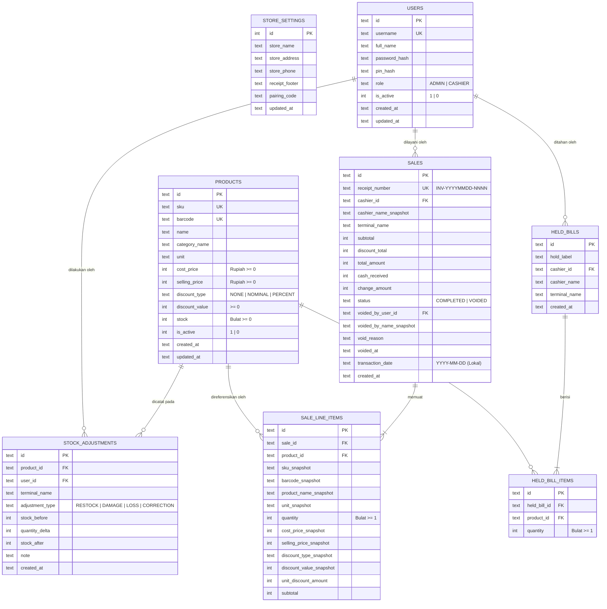

# Desain Sistem & Kontrak Teknis (SYSTEM-DESIGN) — POS-Kasir

Dokumen ini merupakan acuan teknis tingkat implementasi yang memuat skema database SQLite (`schema.sql`), skema konfigurasi lokal (`local_config.json`), daftar lengkap kontrak Tauri IPC Command & LAN HTTP Endpoint, alur transaksi atomik, serta spesifikasi protokol byte **Raw ESC/POS**.

---

## 1. Diagram Relasi Entitas (ERD)



---

## 2. Skema Database SQLite (`src-tauri/src/db/schema.sql`)

Pada saat inisialisasi koneksi SQLite di **Server Terminal**, pragma berikut **wajib** dijalankan sebelum eksekusi query:

```sql
PRAGMA journal_mode = WAL;
PRAGMA synchronous = NORMAL;
PRAGMA foreign_keys = ON;
PRAGMA busy_timeout = 5000;
```

### Definisi Tabel Lengkap (DDL)

```sql
-- 1. Pengaturan Toko (Single-Row Table: id = 1)
CREATE TABLE IF NOT EXISTS store_settings (
    id INTEGER PRIMARY KEY CHECK (id = 1),
    store_name TEXT NOT NULL,
    store_address TEXT NOT NULL DEFAULT '',
    store_phone TEXT NOT NULL DEFAULT '',
    receipt_footer TEXT NOT NULL DEFAULT 'Terima kasih atas kunjungan Anda. Barang yang sudah dibeli tidak dapat ditukar/dikembalikan.',
    pairing_code TEXT NOT NULL,
    updated_at TEXT NOT NULL
);

-- 2. Pengguna (Admin & Cashier)
CREATE TABLE IF NOT EXISTS users (
    id TEXT PRIMARY KEY,
    username TEXT NOT NULL UNIQUE COLLATE NOCASE,
    full_name TEXT NOT NULL,
    password_hash TEXT NOT NULL,
    pin_hash TEXT, -- Wajib terisi jika role = 'ADMIN'
    role TEXT NOT NULL CHECK (role IN ('ADMIN', 'CASHIER')),
    is_active INTEGER NOT NULL DEFAULT 1 CHECK (is_active IN (0, 1)),
    created_at TEXT NOT NULL,
    updated_at TEXT NOT NULL
);

-- 3. Katalog Produk (Satuan Bulat & Stok Non-Negatif)
CREATE TABLE IF NOT EXISTS products (
    id TEXT PRIMARY KEY,
    sku TEXT NOT NULL UNIQUE COLLATE NOCASE,
    barcode TEXT UNIQUE COLLATE NOCASE,
    name TEXT NOT NULL,
    category_name TEXT NOT NULL DEFAULT 'Umum',
    unit TEXT NOT NULL DEFAULT 'pcs',
    cost_price INTEGER NOT NULL CHECK (cost_price >= 0),
    selling_price INTEGER NOT NULL CHECK (selling_price >= 0),
    discount_type TEXT NOT NULL DEFAULT 'NONE' CHECK (discount_type IN ('NONE', 'NOMINAL', 'PERCENT')),
    discount_value INTEGER NOT NULL DEFAULT 0 CHECK (
        discount_value >= 0 AND (discount_type != 'PERCENT' OR discount_value <= 100)
    ),
    stock INTEGER NOT NULL DEFAULT 0 CHECK (stock >= 0),
    is_active INTEGER NOT NULL DEFAULT 1 CHECK (is_active IN (0, 1)),
    created_at TEXT NOT NULL,
    updated_at TEXT NOT NULL
);

CREATE INDEX IF NOT EXISTS idx_products_barcode ON products(barcode) WHERE barcode IS NOT NULL;
CREATE INDEX IF NOT EXISTS idx_products_name ON products(name COLLATE NOCASE);
CREATE INDEX IF NOT EXISTS idx_products_active ON products(is_active);

-- 4. Riwayat Penyesuaian Stok (Stock Adjustment)
CREATE TABLE IF NOT EXISTS stock_adjustments (
    id TEXT PRIMARY KEY,
    product_id TEXT NOT NULL REFERENCES products(id),
    user_id TEXT NOT NULL REFERENCES users(id),
    terminal_name TEXT NOT NULL,
    adjustment_type TEXT NOT NULL CHECK (adjustment_type IN ('RESTOCK', 'DAMAGE', 'LOSS', 'CORRECTION')),
    stock_before INTEGER NOT NULL CHECK (stock_before >= 0),
    quantity_delta INTEGER NOT NULL,
    stock_after INTEGER NOT NULL CHECK (stock_after >= 0),
    note TEXT NOT NULL DEFAULT '',
    created_at TEXT NOT NULL
);

CREATE INDEX IF NOT EXISTS idx_stock_adj_product ON stock_adjustments(product_id, created_at DESC);

-- 5. Transaksi Penjualan (Sale)
CREATE TABLE IF NOT EXISTS sales (
    id TEXT PRIMARY KEY,
    receipt_number TEXT NOT NULL UNIQUE,
    cashier_id TEXT NOT NULL REFERENCES users(id),
    cashier_name_snapshot TEXT NOT NULL,
    terminal_name TEXT NOT NULL,
    subtotal INTEGER NOT NULL CHECK (subtotal >= 0),
    discount_total INTEGER NOT NULL CHECK (discount_total >= 0),
    total_amount INTEGER NOT NULL CHECK (total_amount >= 0),
    cash_received INTEGER NOT NULL CHECK (cash_received >= total_amount),
    change_amount INTEGER NOT NULL CHECK (change_amount >= 0),
    status TEXT NOT NULL DEFAULT 'COMPLETED' CHECK (status IN ('COMPLETED', 'VOIDED')),
    voided_by_user_id TEXT REFERENCES users(id),
    voided_by_name_snapshot TEXT,
    void_reason TEXT,
    voided_at TEXT,
    transaction_date TEXT NOT NULL, -- Format YYYY-MM-DD waktu lokal
    created_at TEXT NOT NULL
);

CREATE INDEX IF NOT EXISTS idx_sales_date_status ON sales(transaction_date, status);
CREATE INDEX IF NOT EXISTS idx_sales_cashier ON sales(cashier_id, transaction_date);

-- 6. Rincian Barang per Transaksi (Line Item dengan Snapshot Harga)
CREATE TABLE IF NOT EXISTS sale_line_items (
    id TEXT PRIMARY KEY,
    sale_id TEXT NOT NULL REFERENCES sales(id) ON DELETE CASCADE,
    product_id TEXT NOT NULL REFERENCES products(id),
    sku_snapshot TEXT NOT NULL,
    barcode_snapshot TEXT,
    product_name_snapshot TEXT NOT NULL,
    unit_snapshot TEXT NOT NULL,
    quantity INTEGER NOT NULL CHECK (quantity >= 1),
    cost_price_snapshot INTEGER NOT NULL CHECK (cost_price_snapshot >= 0),
    selling_price_snapshot INTEGER NOT NULL CHECK (selling_price_snapshot >= 0),
    discount_type_snapshot TEXT NOT NULL CHECK (discount_type_snapshot IN ('NONE', 'NOMINAL', 'PERCENT')),
    discount_value_snapshot INTEGER NOT NULL CHECK (discount_value_snapshot >= 0),
    unit_discount_amount INTEGER NOT NULL CHECK (unit_discount_amount >= 0),
    subtotal INTEGER NOT NULL CHECK (subtotal >= 0)
);

CREATE INDEX IF NOT EXISTS idx_sale_items_sale_id ON sale_line_items(sale_id);
CREATE INDEX IF NOT EXISTS idx_sale_items_product_id ON sale_line_items(product_id);

-- 7. Keranjang Ditahan (Held Bill — Tidak Mengunci Stok)
CREATE TABLE IF NOT EXISTS held_bills (
    id TEXT PRIMARY KEY,
    hold_label TEXT NOT NULL DEFAULT '',
    cashier_id TEXT NOT NULL REFERENCES users(id),
    cashier_name TEXT NOT NULL,
    terminal_name TEXT NOT NULL,
    created_at TEXT NOT NULL
);

CREATE TABLE IF NOT EXISTS held_bill_items (
    id TEXT PRIMARY KEY,
    held_bill_id TEXT NOT NULL REFERENCES held_bills(id) ON DELETE CASCADE,
    product_id TEXT NOT NULL REFERENCES products(id),
    quantity INTEGER NOT NULL CHECK (quantity >= 1)
);
```

---

## 3. Skema Konfigurasi Lokal Per Terminal (`local_config.json`)

Disimpan di `%APPDATA%\com.pos-kasir.app\local_config.json` pada masing-masing komputer:

```json
{
  "terminal_mode": "SERVER",
  "terminal_name": "Kasir Utama (Server)",
  "server_bind_port": 3847,
  "client_target_ip": "127.0.0.1",
  "client_target_port": 3847,
  "pairing_code": "A9K2M7",
  "printer": {
    "printer_name": "EPSON TM-T82 Receipt",
    "paper_width": 80,
    "auto_open_drawer": true,
    "preview_on_screen": false
  }
}
```
- Nilai `terminal_mode`: `"UNCONFIGURED"` (default sebelum *First-Run Wizard*), `"SERVER"`, atau `"CLIENT"`.
- Nilai `paper_width`: `58` (32 karakter per baris) atau `80` (48 karakter per baris).

---

## 4. Kontrak Tauri IPC Commands & LAN HTTP API

Ketika berjalan dalam mode `CLIENT`, Tauri Command meneruskan operasi domain ke endpoint HTTP Axum di **Server Terminal** dengan menyertakan header:
- `X-Pairing-Code: <pairing_code>`
- `X-Session-Token: <token>` (kecuali endpoint health & login)
- `X-Terminal-Name: <terminal_name>`

### 4.1. Tabel Pemetaan Command & Endpoint

| Kategori | Tauri Command (`invoke`) | LAN HTTP Endpoint (`Axum`) | Akses | Deskripsi |
| :--- | :--- | :--- | :--- | :--- |
| **Setup & Lokal** | `get_terminal_status` | *(Lokal + Ping `/api/v1/health`)* | Publik | Mengembalikan isi `local_config.json`, daftar IP LAN lokal (jika Server), dan status keterhubungan ke Server. |
| **Setup & Lokal** | `setup_server_terminal` | *(Lokal di PC Server)* | First-Run | Membuat database SQLite, menyimpan `store_settings`, membuat akun **Admin** pertama, menulis `local_config.json` (`SERVER`), dan menyalakan server Axum. |
| **Setup & Lokal** | `setup_client_terminal` | `GET /api/v1/health` | First-Run | Menguji koneksi & **Pairing Code** ke IP **Server Terminal**; jika valid, menyimpan `local_config.json` (`CLIENT`). |
| **Autentikasi** | `auth_login` | `POST /api/v1/auth/login` | Publik (Paired) | Verifikasi `username` & `password`; mengembalikan profil `User` (`id`, `username`, `full_name`, `role`) dan `session_token`. |
| **Autentikasi** | `auth_logout` | `POST /api/v1/auth/logout` | Cashier, Admin | Menghapus sesi aktif. |
| **Produk** | `list_products` | `GET /api/v1/products` | Cashier, Admin | Daftar produk (filter `search`, `category`, `only_active`). Untuk peran **Cashier**, field `cost_price` disensor (`0` / `null`) atau disembunyikan di UI. |
| **Produk** | `find_product_by_code` | `GET /api/v1/products/lookup?code=` | Cashier, Admin | Pencarian eksak berdasarkan `barcode` atau `sku` untuk pemindaian *Barcode Scanner* berkecepatan tinggi. |
| **Produk** | `upsert_product` | `POST /api/v1/products` | **Admin** | Tambah produk baru atau perbarui produk yang sudah ada. |
| **Produk** | `deactivate_product` | `DELETE /api/v1/products/:id` | **Admin** | *Soft delete* (`is_active = 0`) pada produk. |
| **Produk CSV** | `export_products_csv` | `GET /api/v1/products/csv` | **Admin** | Menghasilkan konten CSV seluruh katalog produk. |
| **Produk CSV** | `import_products_csv` | `POST /api/v1/products/csv` | **Admin** | Upsert massal produk dari file CSV dalam satu transaksi database. |
| **Inventaris** | `create_stock_adjustment` | `POST /api/v1/stock-adjustments` | **Admin** | Mencatat barang masuk/rusak/koreksi dan memperbarui `products.stock` secara atomik. |
| **Inventaris** | `list_stock_adjustments` | `GET /api/v1/stock-adjustments` | **Admin** | Riwayat mutasi penyesuaian stok. |
| **Kasir (Sale)** | `create_sale` | `POST /api/v1/sales` | Cashier, Admin | Menyelesaikan pembayaran tunai secara atomik, memotong stok, dan mengembalikan objek `ReceiptData` lengkap untuk dicetak. |
| **Kasir (Sale)** | `list_today_sales` | `GET /api/v1/sales/today` | Cashier, Admin | Daftar transaksi hari ini beserta rincian **Line Item**. |
| **Kasir (Void)** | `void_sale` | `POST /api/v1/sales/:id/void` | Cashier (+ PIN Admin), Admin | Membatalkan transaksi hari ini dengan verifikasi `admin_pin` & `void_reason`, lalu mengembalikan stok. |
| **Held Bill** | `create_held_bill` | `POST /api/v1/held-bills` | Cashier, Admin | Menyimpan keranjang sementara di server tanpa memotong stok. |
| **Held Bill** | `list_held_bills` | `GET /api/v1/held-bills` | Cashier, Admin | Menampilkan semua keranjang yang sedang ditahan di toko. |
| **Held Bill** | `consume_held_bill` | `POST /api/v1/held-bills/:id/consume` | Cashier, Admin | Mengambil item **Held Bill** beserta status stok terkini dan menghapusnya dari daftar tunggu server. |
| **Laporan** | `get_sales_report` | `GET /api/v1/reports/sales` | **Admin** | Ringkasan omzet, HPP, laba kotor, transaksi sukses/void, produk terlaris, dan daftar transaksi terfilter. |
| **Pengguna** | `list_users` / `upsert_user` | `GET/POST /api/v1/users` | **Admin** | Mengelola akun **Cashier** & **Admin** beserta password dan PIN. |
| **Pengaturan** | `get_store_settings` / `update_store_settings` | `GET/PUT /api/v1/store-settings` | Cashier (Baca), **Admin** (Ubah) | Mengambil/mengubah identitas toko dan **Pairing Code**. |
| **Perangkat Lokal** | `list_local_printers` | *(Selalu Lokal)* | Cashier, Admin | Membaca daftar printer terinstal di Windows PC tersebut. |
| **Perangkat Lokal** | `print_receipt` | *(Selalu Lokal)* | Cashier, Admin | Mengirim byte ESC/POS **Receipt** (dan opsional sinyal buka **Cash Drawer**) ke printer lokal. |
| **Perangkat Lokal** | `test_printer_and_drawer` | *(Selalu Lokal)* | Cashier, Admin | Mencetak struk uji coba dan/atau memantik **Cash Drawer** lokal. |
| **Backup Server** | `backup_database` / `restore_database` | *(Hanya di Server Terminal)* | **Admin** | Mencadangkan (`VACUUM INTO`) atau memulihkan file `pos_kasir.db`. |

---

## 5. Alur Transaksi Atomik (`Sale` & `Void`)

### 5.1. Algoritma Atomik `create_sale`
Untuk menjamin stok tidak pernah minus meskipun 5 kasir menekan tombol Bayar di detik yang sama:

```text
1. Buka transaksi database dengan `BEGIN IMMEDIATE` (mengunci penulisan lain di SQLite hingga selesai).
2. Untuk setiap item { product_id, quantity } di dalam request:
   a. SELECT id, sku, barcode, name, unit, cost_price, selling_price, discount_type, discount_value, stock, is_active
      FROM products WHERE id = ?
   b. Jika produk tidak ditemukan atau is_active == 0 -> ROLLBACK & return Error("Produk tidak aktif").
   c. Jika stock < quantity -> ROLLBACK & return Error("Stok [name] tidak mencukupi (tersisa: [stock])").
   d. Hitung unit_discount_amount dan line_subtotal sesuai BR-01 & BR-02.
   e. UPDATE products SET stock = stock - quantity, updated_at = NOW() WHERE id = ?
3. Hitung subtotal, discount_total, dan total_amount keseluruhan.
4. Validasi cash_received >= total_amount. Jika kurang -> ROLLBACK & return Error("Nominal tunai kurang").
5. Buat receipt_number berurutan untuk tanggal hari ini:
   Format: `INV-YYYYMMDD-NNNN` (contoh: `INV-20261018-0001`).
6. INSERT INTO sales (...) VALUES (...).
7. Untuk setiap item, INSERT INTO sale_line_items (...) dengan nilai snapshot dari langkah 2.
8. COMMIT transaksi.
9. Kembalikan payload ReceiptData ke terminal pemanggil untuk langsung dicetak.
```

### 5.2. Algoritma Atomik `void_sale`
```text
1. Validasi void_reason tidak kosong.
2. Buka transaksi database dengan `BEGIN IMMEDIATE`.
3. Cari user Admin aktif yang cocok dengan `admin_pin` (melalui verifikasi Argon2 terhadap kolom pin_hash pada semua user dengan role = 'ADMIN' dan is_active = 1).
   Jika tidak ada yang cocok -> ROLLBACK & return Error("PIN Admin tidak valid").
4. SELECT status, transaction_date FROM sales WHERE id = ?
   - Jika status == 'VOIDED' -> ROLLBACK & return Error("Transaksi sudah pernah dibatalkan").
   - Jika transaction_date != tanggal_hari_ini_lokal -> ROLLBACK & return Error("Hanya transaksi hari ini yang dapat di-Void").
5. Ambil semua baris dari sale_line_items WHERE sale_id = ?
6. Untuk setiap baris:
   UPDATE products SET stock = stock + quantity, updated_at = NOW() WHERE id = product_id
7. UPDATE sales SET status = 'VOIDED', voided_by_user_id = admin.id, voided_by_name_snapshot = admin.full_name,
   void_reason = ?, voided_at = NOW() WHERE id = ?
8. COMMIT transaksi.
```

---

## 6. Spesifikasi Byte Raw ESC/POS & Tata Letak Struk (`Receipt`)

Backend Rust membangun array `Vec<u8>` sesuai standar **ESC/POS**:

| Perintah | Urutan Byte (Hex) | Fungsi |
| :--- | :--- | :--- |
| **Initialize Printer** | `1B 40` | Reset printer ke mode standar |
| **Align Left / Center / Right** | `1B 61 00` / `1B 61 01` / `1B 61 02` | Perataan teks |
| **Bold On / Off** | `1B 45 01` / `1B 45 00` | Huruf tebal |
| **Feed & Cut Paper** | `1D 56 42 00` (atau `0A` $\times 4$ untuk printer tanpa *auto-cutter*) | Gulung kertas & potong |
| **Kick Cash Drawer (Pin 2 & 5)** | `1B 70 00 19 FA` | Memantik buka **Cash Drawer RJ11** ($50\text{ ms}$ on, $500\text{ ms}$ off) |

### Lebar Kolom Karakter
- **Kertas 58mm**: **32 karakter** per baris (Font A standar).
- **Kertas 80mm**: **48 karakter** per baris (Font A standar).

### Contoh Tata Letak Struk (Mode 58mm / 32 Karakter)
```text
          TOKO MAJU JAYA        
    Jl. Merdeka No. 10, Kota    
        Telp: 08123456789       
--------------------------------
No   : INV-20261018-0012
Tgl  : 18/10/2026 16:05
Kasir: Budi (Kasir 2)
--------------------------------
Indomie Goreng 85g
2 pcs x 3.500              7.000
Aqua Botol 600ml
3 botol x 4.000           12.000
  Diskon Produk          (1.500)
--------------------------------
Subtotal                  19.000
Total Diskon             (1.500)
TOTAL                     17.500
Tunai                     20.000
Kembalian                  2.500
--------------------------------
   Terima kasih atas kunjungan  
              Anda.             
```
*(Jika dicetak ulang melalui fitur **Reprint**, tepat di atas baris pertama item ditambahkan baris tengah: `*** CETAKAN ULANG ***` dan perintah `Kick Cash Drawer` tidak dikirimkan).*
