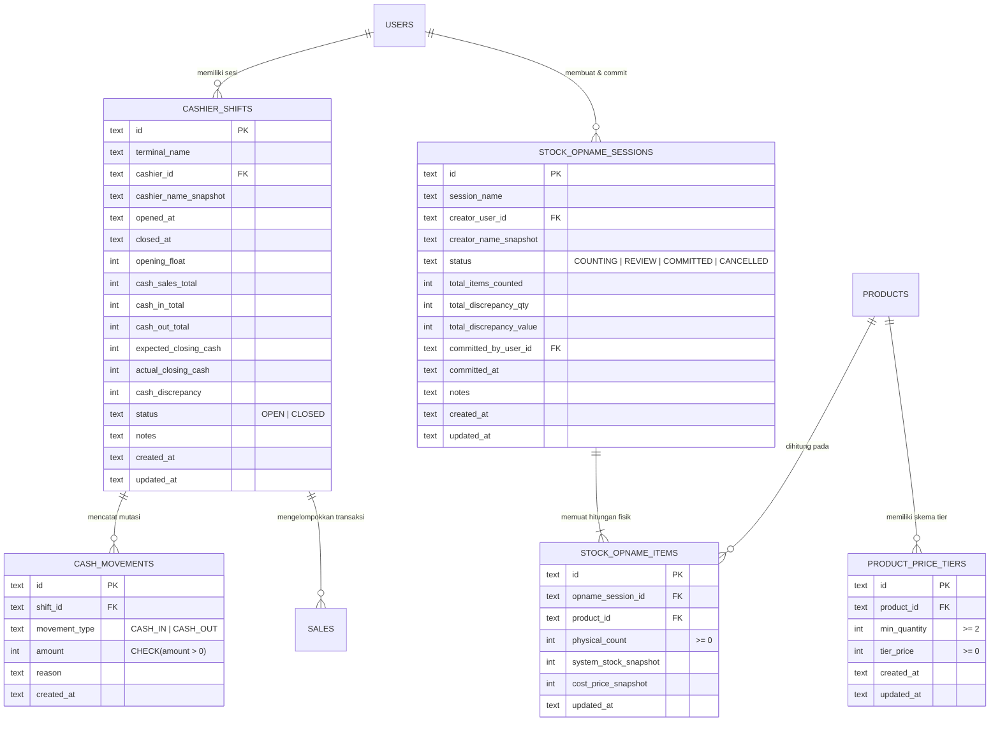

# Modul Operasional Ritel Lanjutan (Shift Kasir, Stok Opname, & Diskon Grosir)

*   **Author:** EGM Draft & Review Swarm
*   **Status:** Approved
*   **Date:** 2026-10-28

--------------------------------------------------------------------------------

## Overview

Dokumen ini merupakan spesifikasi perancangan teknis final untuk pembaruan operasional ritel aplikasi **Mudita Mart** (sistem kasir ritel minimarket SMK Mudita). Tiga kapabilitas utama yang ditambahkan adalah:
1. **Manajemen Shift Kasir & Rekap Kas Laci**: Disiplin kas per kasir per terminal melalui modal awal wajib (`opening float`), pengeluaran/penambahan kas operasional bersyarat saldo (`cash movements`), protokol *Blind Close*, cetak laporan perantara (*X-Report*) dan tutup shift (*Z-Report*), serta pencatatan selisih kas fisik.
2. **Alur Stok Opname Fisik Massal**: Audit inventaris berbasis sesi dengan pemindaian barcode berulang, pembandingan hitungan fisik terhadap stok sistem di bawah model *Store-Closed / Shift Freeze*, pratinjau selisih kuantitas dan nominal rugi/laba sebelum commit atomik berizin PIN Admin di dalam tab `STOCK`.
3. **Diskon Grosir / Harga Bertingkat (Tiered Pricing)**: Penentuan skema harga khusus berdasarkan ambang kuantitas beli yang otomatis dievaluasi secara deterministik pada kalkulasi keranjang `BR-01`, dengan aturan bisnis `BR-04` yang memprioritaskan harga grosir dan menonaktifkan promo reguler guna melindungi margin toko.

Seluruh pembaruan beroperasi penuh secara lokal pada arsitektur Dual-Mode LAN tanpa ketergantungan koneksi cloud atau internet publik.

--------------------------------------------------------------------------------

## The Problem

Operasional harian Mudita Mart menghadapi tiga kendala utama di lantai toko:
1. **Ketidakjelasan Akuntabilitas Kas Laci**: Kasir berganti giliran kerja tanpa verifikasi modal awal dan penghitungan uang fisik akhir. Jika terjadi kekurangan uang di laci saat setoran malam, pengelola toko tidak dapat melacak pada kasir atau jam berapa selisih tersebut timbul.
2. **Ketiadaan Alur Audit Fisik Terisolasi**: Modul stok saat ini hanya mencatat koreksi item per item secara ad-hoc, sedangkan impor Excel langsung menimpa data tanpa isolasi sesi. Staf toko tidak memiliki instrumen untuk menghitung fisik rak secara sistematis, meninjau ringkasan selisih rugi/laba, dan mendapatkan persetujuan Admin sebelum stok diperbarui.
3. **Keterbatasan Fleksibilitas Promosi Kuantitas**: Toko minimarket sekolah membutuhkan harga grosir untuk pembelian volume banyak (misalnya alat tulis untuk kelas atau jajanan kardus). Diskon produk saat ini hanya berupa potongan harga datar tanpa batas minimal pembelian, memaksa staf kasir melakukan hitung manual di luar sistem.

--------------------------------------------------------------------------------

## Goals

### Milestone 1: Manajemen Shift Kasir & Rekap Kas Laci
*   Mencatat siklus hidup shift kasir per terminal (`OPEN` -> `CLOSED`).
*   Mewajibkan input modal awal laci (`opening_float`) sebelum kasir dapat memproses transaksi penjualan pertama.
*   Menyediakan pencatatan mutasi kas operasional kasir (`CASH_IN` dan `CASH_OUT` / cash drop) dengan validasi batas saldo kas laci berjalan.
*   Menerapkan protokol **Blind Close**: kasir memasukkan uang fisik laci tanpa diperlihatkan saldo kas sistem terlebih dahulu untuk mencegah manipulasi fisik kas.
*   Menyediakan cetak struk ESC/POS 58mm/80mm untuk **X-Report** (audit kasir tengah berjalan) dan **Z-Report** (tutup shift permanen dengan ringkasan omzet tunai bersih, retur/void, dan selisih kas fisik).
*   Menghitung selisih kas secara matematis akurat:
    `expected_closing_cash = opening_float + net_cash_sales - cash_void_total + cash_in_total - cash_out_total`.

### Milestone 2: Alur Stok Opname Fisik Massal
*   Mendukung pembuatan sesi opname (`stock_opname_sessions`) dengan metadata tanggal, nama sesi, petugas, dan status (`COUNTING`, `REVIEW`, `COMMITTED`, `CANCELLED`).
*   Menerapkan model **Store-Closed / Shift Freeze**: transaksi penjualan pada produk yang sedang diaudit dibekukan selama penghitungan fisik untuk menjamin integritas mutasi stok saat commit tanpa risiko *phantom stock*.
*   Memungkinkan pemindaian barcode berulang di keranjang opname fisik dengan akumulasi kuantitas otomatis.
*   Menyediakan tabel perbandingan selisih: Stok Sistem, Hitungan Fisik, Selisih Kuantitas, dan Estimasi Nilai Rupiah Selisih (berdasarkan Cost Price / HPP).
*   Mewajibkan otorisasi PIN Admin untuk mengeksekusi commit perubahan stok secara atomik (`BEGIN IMMEDIATE`) ke tabel `products` dan mencatat riwayat ke `stock_adjustments`.
*   Menyediakan ekspor laporan hasil opname ke spreadsheet Excel 2-sheet via `excelService`.

### Milestone 3: Diskon Grosir / Harga Bertingkat (Tiered Pricing)
*   Menyimpan skema harga bertingkat per produk (ambang `min_quantity >= 2` dan `tier_price >= cost_price`) langsung di dalam modal produk `ProductFormModal.tsx`.
*   Memperbarui algoritma keranjang `BR-01` untuk mengevaluasi tier harga tertinggi yang memenuhi syarat kuantitas secara deterministik.
*   **Aturan Bisnis `BR-04` (Prioritas Tier Grosir)**: Saat tier harga grosir aktif pada suatu baris item, diskon promo per produk (nominal/persen) dinonaktifkan (`unit_discount = 0`) untuk memproteksi margin keuntungan toko dari diskon ganda di bawah HPP.
*   Menampilkan indikator tier grosir aktif dan total penghematan di layar kasir (`PosRegisterPage`).
*   Mencetak harga tier dan rincian penghematan pada struk belanja ESC/POS.

--------------------------------------------------------------------------------

## Non-Goals

*   Tidak mencakup penggajian kasir, insentif komisi penjualan, atau absensi presensi pegawai.
*   Tidak mengizinkan stok minus (*negative inventory*) atau penjualan inden (*backorder*).
*   Tidak mencakup integrasi pembacaan timbangan digital otomatis (RS-232/USB scale) untuk barang desimal curah.
*   Tidak mencakup integrasi payment gateway perbankan berbasis internet.
*   Tidak mencakup sinkronisasi stok opname multi-cabang terdistribusi melalui internet.
*   Tidak menerapkan mandatori PIN Admin pada selisih koin receh saat tutup shift agar tidak melumpuhkan pergantian kasir siswa (cukup catatan alasan kasir).
*   Tidak menerapkan paginasi pada endpoint opname karena katalog minimarket sekolah (< 2.000 SKU) menghasilkan payload sangat ringan (< 150 KB).

--------------------------------------------------------------------------------

## Open Questions

*   **Status: Selesai / Seluruh Pertanyaan Terpecahkan**
    1. *Status Transaksi Saat Opname Berjalan*: **Diputuskan Menggunakan Model Store-Closed / Shift Freeze**. Audit dilakukan saat toko tutup atau penjualan pada produk yang diaudit dibekukan sementara. Pada `create_sale`, sistem menolak transaksi produk jika terdapat sesi opname berstatus `COUNTING` pada produk tersebut, menjamin kepastian mutasi stok saat sesi di-commit.
    2. *Resolusi Konflik Diskon Promo vs Diskon Grosir*: **Diputuskan Menggunakan Aturan Bisnis `BR-04`**. Saat kuantitas item di keranjang belanja mencapai ambang batas tier grosir, harga satuan disetel ke harga tier dan diskon promo reguler dinonaktifkan (`unit_discount = 0`).

--------------------------------------------------------------------------------

## Critical User Journeys (CUJs)

### CUJ 1: Buka Shift, Mutasi Kas Operasional, dan Tutup Shift Kasir (Blind Close & Z-Report)

*   **Given**: Kasir telah berhasil login ke terminal kasir. Belum ada shift aktif untuk terminal tersebut.
*   **When**: Kasir membuka halaman Kasir. Sistem menampilkan dialog modal wajib `ShiftOpenModal` yang meminta nominal modal awal laci (misal Rp 150.000). Kasir mengisi modal, melayani 20 transaksi tunai, mencatat pengeluaran kas darurat beli lakban Rp 10.000 (`CASH_OUT`), lalu di akhir giliran kerja menekan "Tutup Shift". Dialog `ShiftCloseModal` muncul tanpa memperlihatkan saldo kas sistem (*Blind Close*). Kasir menghitung fisik uang kertas/koin di laci (misal Rp 840.000), memasukkannya ke input form, lalu menekan verifikasi.
*   **Then**: Sistem memvalidasi `expected_closing_cash = opening_float + net_cash_sales - cash_void_total + cash_in_total - cash_out_total`, menghitung selisih (`cash_discrepancy = actual - expected`), menampilkan ringkasan, mencetak struk Z-Report pada printer ESC/POS, mengunci shift menjadi `CLOSED`, dan memantik pulsa laci kasir RJ11 terbuka untuk serah-terima.

### CUJ 2: Pelaksanaan Stok Opname Rak Toko (Shift Freeze & Commit Selisih)

*   **Given**: Admin membuka sesi stok opname baru "Opname Bulanan Rak ATK & Jajanan" di sub-tab "Audit Opname Fisik" pada halaman `StockAdjustmentPage.tsx` di Server Terminal. Sesi berstatus `COUNTING`.
*   **When**: Staf toko berkeliling membawa scanner barcode USB, memindai barcode produk berulang kali untuk mencatat fisik barang yang ditemukan. Setelah selesai, staf beralih ke tahap `REVIEW`. Sistem menampilkan ringkasan 2 item kurang dan 1 item lebih dengan nilai selisih minus Rp 15.000. Admin memeriksa fisik barang, memasukkan PIN 6 digit miliknya, dan menekan "Terapkan Selisih Stok ke Inventaris".
*   **Then**: Sistem mengeksekusi commit atomik SQLite (`BEGIN IMMEDIATE`), mengupdate stok fisik pada tabel `products`, menyisipkan log penyesuaian di `stock_adjustments`, mengunci sesi menjadi `COMMITTED`, dan menyediakan tombol unduh laporan Excel 2-sheet.

### CUJ 3: Transaksi Kasir Menggunakan Harga Grosir Bertingkat

*   **Given**: Produk "Buku Tulis Sinar Dunia 38" memiliki harga satuan normal Rp 4.500. Dikonfigurasi tier grosir: beli >= 10 pcs harga menjadi Rp 3.900/pcs.
*   **When**: Kasir memindai produk tersebut sebanyak 12 pcs ke dalam keranjang belanja di `PosRegisterPage`.
*   **Then**: Baris item otomatis menerapkan harga satuan Rp 3.900, menonaktifkan promo reguler (`BR-04`), menghitung subtotal `12 x Rp 3.900 = Rp 46.800`, menampilkan badge "Grosir Aktif (Hemat Rp 7.200)" di antarmuka kasir, dan struk belanja mencetak harga grosir satuan yang transparan.

--------------------------------------------------------------------------------

## Technical Plan (Architecture)

### 1. Arsitektur Data & Skema Database SQLite



#### DDL Skema SQLite Konkret
```sql
-- 1. Sesi Shift Kasir
CREATE TABLE IF NOT EXISTS cashier_shifts (
    id TEXT PRIMARY KEY,
    terminal_name TEXT NOT NULL,
    cashier_id TEXT NOT NULL REFERENCES users(id),
    cashier_name_snapshot TEXT NOT NULL,
    opened_at TEXT NOT NULL,
    closed_at TEXT,
    opening_float INTEGER NOT NULL CHECK (opening_float >= 0),
    cash_sales_total INTEGER NOT NULL DEFAULT 0,
    cash_in_total INTEGER NOT NULL DEFAULT 0,
    cash_out_total INTEGER NOT NULL DEFAULT 0,
    expected_closing_cash INTEGER,
    actual_closing_cash INTEGER,
    cash_discrepancy INTEGER,
    status TEXT NOT NULL CHECK (status IN ('OPEN', 'CLOSED')),
    notes TEXT,
    created_at TEXT NOT NULL,
    updated_at TEXT NOT NULL
);

-- 2. Mutasi Kas Operasional Laci
CREATE TABLE IF NOT EXISTS cash_movements (
    id TEXT PRIMARY KEY,
    shift_id TEXT NOT NULL REFERENCES cashier_shifts(id) ON DELETE CASCADE,
    movement_type TEXT NOT NULL CHECK (movement_type IN ('CASH_IN', 'CASH_OUT')),
    amount INTEGER NOT NULL CHECK (amount > 0),
    reason TEXT NOT NULL,
    created_at TEXT NOT NULL
);

-- 3. Sesi Audit Stok Opname Fisik
CREATE TABLE IF NOT EXISTS stock_opname_sessions (
    id TEXT PRIMARY KEY,
    session_name TEXT NOT NULL,
    creator_user_id TEXT NOT NULL REFERENCES users(id),
    creator_name_snapshot TEXT NOT NULL,
    status TEXT NOT NULL CHECK (status IN ('COUNTING', 'REVIEW', 'COMMITTED', 'CANCELLED')),
    total_items_counted INTEGER NOT NULL DEFAULT 0,
    total_discrepancy_qty INTEGER NOT NULL DEFAULT 0,
    total_discrepancy_value INTEGER NOT NULL DEFAULT 0,
    committed_by_user_id TEXT REFERENCES users(id),
    committed_at TEXT,
    notes TEXT,
    created_at TEXT NOT NULL,
    updated_at TEXT NOT NULL
);

-- 4. Item Hitungan Fisik Sesi Opname (Ramping, Tanpa Duplikasi Snapshot Berlebihan)
CREATE TABLE IF NOT EXISTS stock_opname_items (
    id TEXT PRIMARY KEY,
    opname_session_id TEXT NOT NULL REFERENCES stock_opname_sessions(id) ON DELETE CASCADE,
    product_id TEXT NOT NULL REFERENCES products(id),
    physical_count INTEGER NOT NULL DEFAULT 0 CHECK (physical_count >= 0),
    system_stock_snapshot INTEGER NOT NULL,
    cost_price_snapshot INTEGER NOT NULL,
    updated_at TEXT NOT NULL,
    CONSTRAINT uq_opname_item UNIQUE (opname_session_id, product_id)
);

-- 5. Skema Harga Grosir Bertingkat
CREATE TABLE IF NOT EXISTS product_price_tiers (
    id TEXT PRIMARY KEY,
    product_id TEXT NOT NULL REFERENCES products(id) ON DELETE CASCADE,
    min_quantity INTEGER NOT NULL CHECK (min_quantity >= 2),
    tier_price INTEGER NOT NULL CHECK (tier_price >= 0),
    created_at TEXT NOT NULL,
    updated_at TEXT NOT NULL,
    CONSTRAINT uq_product_tier UNIQUE (product_id, min_quantity)
);

-- 6. Indeks Performa
CREATE INDEX IF NOT EXISTS idx_sales_shift_id ON sales(shift_id);
CREATE INDEX IF NOT EXISTS idx_product_price_tiers_product_id ON product_price_tiers(product_id);
CREATE INDEX IF NOT EXISTS idx_opname_items_session ON stock_opname_items(opname_session_id);
```

---

### 2. Modul Backend Rust (`CoreService` & `BackendDispatcher`)

#### A. Sub-Modul Shift Kasir
*   `open_shift(terminal_name, cashier_id, opening_float, notes) -> Result<CashierShift>`:
    *   Memeriksa apakah ada shift yang berstatus `OPEN` pada terminal atau kasir tersebut. Jika ada, tolak dengan error validasi.
    *   Menyimpan baris baru dengan status `OPEN`.
*   `record_cash_movement(shift_id, movement_type, amount, reason) -> Result<CashMovement>`:
    *   Validasi batas saldo: jika `movement_type == CASH_OUT`, hitung saldo kas berjalan `current_cash = opening_float + net_cash_sales + cash_in - cash_out`. Jika `amount > current_cash`, tolak dengan error `InsufficientDrawerCash`.
    *   Menyimpan mutasi ke `cash_movements`.
*   `get_shift_x_report(shift_id) -> Result<ShiftReportData>`:
    *   Menghitung agregasi saldo berjalan via SQL real-time:
        *   `net_cash_sales = SUM(total_amount)` dari `sales` di mana `shift_id = ? AND status = 'COMPLETED' AND payment_method = 'CASH'`.
        *   `void_count` & `cash_void_total` dari `sales` di mana `shift_id = ? AND status = 'VOIDED' AND payment_method = 'CASH'`.
        *   `cash_in_total` dan `cash_out_total` dari `cash_movements`.
        *   `current_balance = opening_float + net_cash_sales + cash_in_total - cash_out_total`.
*   `close_shift(shift_id, actual_closing_cash, notes) -> Result<ShiftReportData>`:
    *   Menghitung `expected_closing_cash` dan `cash_discrepancy = actual_closing_cash - expected_closing_cash`.
    *   Memperbarui baris `cashier_shifts`: set status `CLOSED`, simpan `closed_at`, `actual_closing_cash`, `expected_closing_cash`, `cash_discrepancy`, dan `notes`.

#### B. Sub-Modul Stok Opname Fisik
*   `create_opname_session(name, creator_user_id, notes) -> Result<StockOpnameSession>`:
    *   Membuat sesi baru dengan status `COUNTING`.
*   `record_opname_scan(session_id, barcode_or_sku, qty_delta) -> Result<StockOpnameItem>`:
    *   Mencari produk berdasarkan barcode/SKU. Jika tidak ditemukan, kembalikan error `ProductNotFound`.
    *   Jika produk belum ada di `stock_opname_items`, ambil snapshot stok sistem dan HPP (`system_stock_snapshot = product.stock`, `cost_price_snapshot = product.cost_price`), insert item dengan `physical_count = qty_delta`.
    *   Jika sudah ada, akumulasikan `physical_count += qty_delta`.
*   `commit_opname_session(session_id, admin_user_id, admin_pin) -> Result<OpnameCommitResult>`:
    *   Verifikasi PIN Admin via `argon2`.
    *   Buka transaksi atomik `BEGIN IMMEDIATE`:
        *   Untuk setiap item opname:
            *   Hitung `discrepancy = item.physical_count - item.system_stock_snapshot`.
            *   Update `products.stock = item.physical_count`.
            *   Jika `discrepancy != 0`, catat baris penyesuaian di `stock_adjustments` dengan tipe `CORRECTION`, `stock_before = item.system_stock_snapshot`, `quantity_delta = discrepancy`, `stock_after = item.physical_count`, dan referensi nama sesi opname.
        *   Update status sesi opname menjadi `COMMITTED`, isi `committed_at` dan `committed_by_user_id`.
        *   Eksekusi `COMMIT`.

#### C. Sub-Modul Harga Grosir Bertingkat (`pricing_service.rs` / `CoreService`)
*   `set_product_price_tiers(product_id, tiers: Vec<PriceTierInput>) -> Result<()>`:
    *   Validasi: `min_quantity >= 2`, `tier_price >= cost_price`, `tier_price < product.selling_price`.
    *   Simpan konfigurasi tier secara atomik di dalam transaksi produk.
*   Aturan Kalkulasi Keranjang (`posCalculator.ts` & `core_service.rs`):
    *   Pilih tier dengan `min_quantity` terbesar yang memenuhi `item.quantity >= tier.min_quantity`.
    *   Jika tier grosir terpicu, terapkan harga tier grosir dan set `unit_discount = 0` (`BR-04`).

---

### 3. Kontrak Jaringan LAN (Axum Endpoints & Tauri IPC)

Seluruh rute HTTP LAN menerapkan proteksi middleware `verify_pairing_header` yang mewajibkan header `X-Pairing-Code` dan `X-Terminal-Name`.

#### Endpoint HTTP LAN (`Axum`)
*   `POST /api/v1/shifts/open` — Body: `{ opening_float: number, terminal_name: string, notes?: string }`
*   `GET  /api/v1/shifts/active?terminal_name=...` — Kembalian: `CashierShift | null`
*   `POST /api/v1/shifts/movement` — Body: `{ shift_id: string, movement_type: "CASH_IN" | "CASH_OUT", amount: number, reason: string }`
*   `GET  /api/v1/shifts/:id/x-report` — Kembalian: `ShiftReportData`
*   `POST /api/v1/shifts/close` — Body: `{ shift_id: string, actual_closing_cash: number, notes?: string }`
*   `GET  /api/v1/shifts/history?start_date=...&end_date=...` — Kembalian: `CashierShift[]`
*   `POST /api/v1/opname/sessions` — Body: `{ session_name: string, notes?: string }`
*   `GET  /api/v1/opname/sessions` — Kembalian: `StockOpnameSession[]`
*   `GET  /api/v1/opname/sessions/:id` — Kembalian: `{ session: StockOpnameSession, items: StockOpnameItemDetail[] }`
*   `POST /api/v1/opname/scan` — Body: `{ session_id: string, barcode_or_sku: string, qty_delta: number }`
*   `PUT  /api/v1/opname/items/:id` — Body: `{ physical_count: number }`
*   `POST /api/v1/opname/commit` — Body: `{ session_id: string, admin_pin: string }`
*   `POST /api/v1/opname/cancel` — Body: `{ session_id: string, reason: string }`

#### Perintah Tauri IPC (`#[tauri::command]`)
*   Seluruh endpoint di atas memiliki wrapper perintah IPC identik di `src-tauri/src/commands/mod.rs` yang diteruskan via `BackendDispatcher`.
*   Pencetakan laporan shift: fungsi formatting ESC/POS menghasilkan buffer byte dan memanggil fungsi spooler terpadu `print_receipt_local`.

---

### 4. Spesifikasi Cetak Struk ESC/POS (X-Report & Z-Report)

#### Wireframe Struk X-Report (Audit Perantara 58mm / 32 Karakter)
```text
================================
         MUDITA MART
     LAPORAN X (SEMENTARA)
================================
Terminal   : Kasir 1
Kasir      : Siti Aminah
Waktu Buka : 2026-10-28 07:00
Waktu Cetak: 2026-10-28 12:30
--------------------------------
Modal Awal (Float)  : Rp 100.000
Penjualan Tunai Net : Rp 750.000
Total Kas Masuk     : Rp       0
Total Kas Keluar    : Rp  15.000
--------------------------------
Saldo Kas Fisik Laci: Rp 835.000
--------------------------------
Total Transaksi     : 42
Transaksi Void      : 1 (Rp 15.000)
================================
  [STATUS SHIFT: MASIH AKTIF]
================================
```

#### Wireframe Struk Z-Report (Tutup Shift Final 58mm / 32 Karakter)
```text
================================
         MUDITA MART
     LAPORAN Z (TUTUP SHIFT)
================================
Terminal   : Kasir 1
Kasir      : Siti Aminah
Buka Shift : 2026-10-28 07:00
Tutup Shift: 2026-10-28 16:00
--------------------------------
Modal Awal (Float)  : Rp 100.000
Penjualan Tunai Net : Rp 1.450.000
Total Kas Masuk     : Rp       0
Total Kas Keluar    : Rp  50.000
--------------------------------
Kas Sistem Diharapkan: Rp 1.500.000
Kas Fisik Dihitung  : Rp 1.500.000
--------------------------------
Selisih Kas Fisik   : Rp       0
Status Selisih      : PAS / SESUAI
--------------------------------
Total Transaksi     : 86
Transaksi Void      : 2 (Rp 30.000)
================================
Catatan: Tutup shift normal
================================
   [STATUS SHIFT: CLOSED]
================================
```
*   Perintah pulsa laci RJ11 (`ESC p 0 25 250`) dipicu secara otomatis sebelum baris akhir Z-Report.
*   Perintah pemotong kertas (`GS V 66 0`) dieksekusi di akhir struk.

---

### 5. Antarmuka Pengguna & Integrasi Layar (Frontend)

1.  **Layar Kasir (`PosRegisterPage.tsx`)**:
    *   **Shift Barrier Guard**: Jika belum ada shift berstatus `OPEN`, antarmuka kasir menampilkan dialog modal terpusat `ShiftOpenModal` dan memblokir input barcode/pembayaran hingga modal awal diinput.
    *   **Tombol Shift Cockpit**: Menampilkan status shift, tombol mutasi kas cepat (`F7 - Kas Masuk/Keluar`), tombol `Cetak Laporan X`, dan tombol `Tutup Shift (Z-Report)`.
    *   **Visualisasi Tier Grosir**: Di keranjang belanja, jika kuantitas item mencapai tier harga grosir, baris item menyorot harga baru dengan lencana hijau "Grosir" dan menampilkan nilai hemat rupiah.
2.  **Layar Manajemen Stok (`StockAdjustmentPage.tsx`)**:
    *   Menambahkan sub-tab view horizontal: **"Koreksi Stok Ad-Hoc"** (tampilan eksisting) dan **"Audit Opname Fisik"** (alur baru).
    *   Mode pemindaian barcode cepat terfokus di lorong rak.
    *   Tabel audit selisih dengan filter: "Semua", "Hanya yang Selisih", "Kurang Stok", "Lebih Stok".
    *   Modal otorisasi PIN Admin saat menekan tombol "Terapkan Selisih Stok ke Inventaris".
3.  **Layar Katalog Produk (`ProductFormModal.tsx`)**:
    *   Penambahan tab "Harga Grosir / Tier" di dalam modal produk untuk menambah/mengedit baris `min_quantity` dan `tier_price`.
    *   Dukungan impor/ekspor Excel: kolom tambahan tier harga pada template spreadsheet Excel.
4.  **Layar Laporan (`ReportsPage.tsx`)**:
    *   Tab baru "Laporan Shift & Kasir" yang menampilkan rekonsiliasi seluruh sesi shift historis beserta selisih kas per kasir.

--------------------------------------------------------------------------------

## Risks & Mitigations

### 1. Partisi Jaringan LAN saat Tutup Shift Klien (LAN Disconnection)
*   **Risiko**: Terminal kasir klien mengirimkan permintaan tutup shift, namun jaringan Wi-Fi toko terputus tepat sebelum respon diterima, berpotensi memicu klik ganda kasir.
*   **Mitigasi**: Logika `close_shift` di backend Rust bersifat *idempotent*. Jika sesi shift sudah berstatus `CLOSED`, pemanggilan ulang dengan ID shift yang sama langsung mengembalikan data laporan Z-Report yang sudah dibekukan tanpa mengubah angka selisih kas.

### 2. Kegagalan Kertas Printer saat Cetak Struk Z-Report
*   **Risiko**: Kertas thermal printer habis di tengah-tengah pencetakan Z-Report final.
*   **Mitigasi**: Karena data ringkasan shift telah tersimpan permanen di database saat status menjadi `CLOSED`, kasir dapat memasang gulungan kertas baru dan menekan tombol *"Cetak Ulang Z-Report"* di riwayat shift tanpa memicu penutupan shift ganda.

### 3. Integritas Inventaris saat Audit Opname Fisik Berjalan
*   **Risiko**: Kasir menjual barang di terminal lain saat fisik barang baru saja dihitung di rak, menyebabkan perbedaan stok riil vs sistem.
*   **Mitigasi**: Menerapkan model *Store-Closed / Shift Freeze*. Pada saat sesi opname berstatus `COUNTING`, fungsi `create_sale` memblokir penjualan produk yang berada dalam cakupan opname dengan notifikasi *"Produk sedang dalam proses audit fisik inventaris"*.

### 4. Validasi Solvabilitas Kas Keluar Laci (Preventing Negative Drawer Balance)
*   **Risiko**: Kasir salah mengetik nominal pengeluaran kas (`CASH_OUT`) yang melebihi jumlah uang tunai fisik yang ada di laci.
*   **Mitigasi**: Backend Rust menghitung saldo laci berjalan saat itu (`opening_float + net_cash_sales + cash_in - cash_out`). Jika nominal mutasi keluar melebihi saldo laci, transaksi ditolak dengan pesan error *"Nominal pengeluaran melebihi sisa uang kas tunai di laci"*.

--------------------------------------------------------------------------------

## Alternatives Considered

### Alternative A: Rekap Shift Kasir Hanya di Memori / LocalStorage Frontend
*   **Pros**: Tidak memerlukan tabel baru di SQLite.
*   **Cons**: Rentan kehilangan data jika komputer mati mendadak atau listrik padam. Server tidak bisa memantau transaksi kasir secara real-time.
*   **Reason for Rejection**: Melanggar prinsip keandalan data transaksi finansial toko ritel.

### Alternative B: Menggunakan Fitur Impor/Ekspor Excel yang Ada untuk Stok Opname
*   **Pros**: Memanfaatkan pustaka `exceljs` yang sudah ada tanpa antarmuka baru.
*   **Cons**: Impor Excel menimpa data tanpa isolasi sesi, rawan *race condition*, dan tidak mendukung alur pemindaian barcode langsung di lorong rak.
*   **Reason for Rejection**: Risiko tabrakan data tinggi dan tidak memenuhi standar audit inventaris fisik.

### Alternative C: Akumulasi Diskon Promo Ditumpuk di Atas Harga Grosir (Stackable Discounts)
*   **Pros**: Memberikan diskon maksimal untuk pembeli volume.
*   **Cons**: Berisiko tinggi menyebabkan harga jual akhir turun di bawah harga modal beli (*Cost Price* / HPP), merusak margin laba, dan membuat rumus struk membingungkan.
*   **Reason for Rejection**: Mengancam margin keuntungan toko ritel minimarket. Diadopsi aturan bisnis `BR-04` (grosir mengesampingkan promo reguler).

--------------------------------------------------------------------------------

## Non-Functional Requirements

### 1. Keandalan & Integritas Data (Data Integrity)
*   Seluruh mutasi stok opname dan penutupan shift kasir **wajib** dieksekusi di dalam transaksi atomik SQLite (`BEGIN IMMEDIATE ... COMMIT`).
*   Invarian mutlak: stok produk dilarang bernilai negatif (`stock >= 0`).

### 2. Performa & Waktu Respons (Performance & Latency)
*   Pencarian barcode dan kalkulasi tier harga grosir di keranjang belanja wajib selesai dalam waktu kurang dari **50 ms**.
*   Pencetakan struk Z-Report dan X-Report via *Win32 Raw Print Spooler* harus dimulai dalam waktu kurang dari **200 ms**.

### 3. Kompatibilitas Operasional Offline & Rollback (Offline-First Safety)
*   Sistem tidak boleh melakukan pemanggilan jaringan di luar subnet LAN lokal toko.
*   Migrasi skema database harus bersifat *additive* via `CREATE TABLE IF NOT EXISTS` dan penambahan kolom aman, sehingga data v1.0.0 tetap kompatibel 100%.

--------------------------------------------------------------------------------

## Detailed Implementation Plan (Phased Execution)

### Fase 1: Fondasi Skema Basis Data SQLite & Domain Models Rust

*Tujuan: Memastikan tabel-tabel baru dan kolom migrasi terpasang secara idempotent di basis data lokal tanpa merusak data v1.0.0, serta model struct Rust terdefinisi lengkap.*

#### Berkas Target Fase 1:
1. `src-tauri/src/db/schema.sql` (Modify)
   * Menambahkan DDL untuk tabel `cashier_shifts`, `cash_movements`, `stock_opname_sessions`, `stock_opname_items`, dan `product_price_tiers` dengan constraint `UNIQUE` dan `CHECK`.
2. `src-tauri/src/db/mod.rs` (Modify)
   * Menambahkan logika migrasi otomatis saat aplikasi dibuka: memeriksa keberadaan kolom `shift_id` pada `sales`, serta `applied_tier_min_qty` dan `applied_tier_price` pada `sale_line_items` via `PRAGMA table_info` dan mengeksekusi `ALTER TABLE ADD COLUMN` jika belum ada.
3. `src-tauri/src/models/mod.rs` (Modify)
   * Menambahkan definisi struct serializable Rust: `CashierShift`, `CashMovement`, `StockOpnameSession`, `StockOpnameItem`, `ProductPriceTier`, serta DTO request/response (`OpenShiftRequest`, `CloseShiftRequest`, `CashMovementRequest`, `OpnameScanRequest`, `OpnameCommitRequest`, `SetPriceTiersRequest`).

*Checkpoint Fase 1*: `cargo check` di folder `src-tauri/` berhasil tanpa error tipe, dan unit test inisialisasi basis data SQLite lulus 100%.

---

### Fase 2: Logika Inti Backend Rust & Pengujian Unit Domain

*Tujuan: Mengimplementasikan seluruh aturan bisnis transaksi atomik untuk shift kasir, stok opname beku, dan kalkulasi harga grosir di dalam backend Rust.*

#### Berkas Target Fase 2:
4. `src-tauri/src/services/core_service.rs` (Modify)
   * *Shift*: Fungsi `open_shift`, `get_active_shift`, `record_cash_movement` (dengan validasi saldo kas keluar), `close_shift` (perhitungan selisih kas), dan `get_shift_report_data` (query agregasi net cash sales & void).
   * *Opname*: Fungsi `create_opname_session`, `list_opname_sessions`, `get_opname_session_detail`, `record_opname_scan`, `update_opname_item_qty`, `commit_opname_session` (atomik `BEGIN IMMEDIATE` yang memutasi stok dan menulis `stock_adjustments`), serta `cancel_opname_session`.
   * *Opname Guard di Kasir*: Memodifikasi `create_sale` untuk memeriksa sesi opname `COUNTING` aktif dan menolak checkout produk yang sedang diaudit.
   * *Grosir*: Fungsi `set_product_price_tiers` dan integrasi aturan `BR-04` pada `calculate_sale_subtotal`.
5. Unit Tests di `src-tauri/src/services/core_service.rs` (Modify)
   * Menambahkan test suite backend: siklus buka-tutup shift, validasi kas minus, penolakan transaksi saat opname aktif, dan commit atomik penyesuaian stok.

*Checkpoint Fase 2*: Seluruh tes unit backend di `src-tauri/` lulus dengan `cargo test`.

---

### Fase 3: Komunikasi LAN Axum/Reqwest & Perintah Tauri IPC

*Tujuan: Membuka endpoint HTTP LAN pada Server Terminal, menghubungkan klien HTTP Reqwest pada Client Terminal, dan mendaftarkan perintah Tauri IPC ke makro handler.*

#### Berkas Target Fase 3:
6. `src-tauri/src/services/dispatcher.rs` (Modify)
   * Menambahkan metode pendelegasian Dual-Mode LAN untuk seluruh fitur baru (mengarahkan langsung ke `CoreService` di mode Server, atau memanggil `lan::client` di mode Client).
7. `src-tauri/src/lan/server.rs` (Modify)
   * Mendaftarkan rute Axum: `/api/v1/shifts/*`, `/api/v1/opname/*`, dan `/api/v1/products/:id/tiers` dengan proteksi middleware pairing code.
8. `src-tauri/src/lan/client.rs` (Modify)
   * Mengimplementasikan fungsi HTTP Reqwest klien untuk pemanggilan remote seluruh endpoint baru.
9. `src-tauri/src/commands/mod.rs` (Modify)
   * Menambahkan deklarasi perintah IPC `#[tauri::command]` untuk shift, mutasi kas, opname fisik, dan harga bertingkat.
10. `src-tauri/src/lib.rs` (Modify)
    * Mendaftarkan seluruh perintah IPC baru di dalam makro `.invoke_handler(tauri::generate_handler![...])`.

*Checkpoint Fase 3*: `cargo check` lulus, dan pengujian integrasi perintah IPC berjalan mulus.

---

### Fase 4: Engine Kalkulasi Keranjang, Context State, & Hardware Spooler

*Tujuan: Memperbarui logika matematika keranjang belanja frontend, sinkronisasi state shift antar-komponen, dan layout cetak struk ESC/POS.*

#### Berkas Target Fase 4:
11. `src/types/domain.ts` (Modify)
    * Menambahkan definisi tipe TypeScript untuk `CashierShift`, `CashMovement`, `StockOpnameSession`, `StockOpnameItem`, `ProductPriceTier`, dan DTO IPC terkait.
12. `src/services/ipc.ts` (Modify)
    * Menambahkan wrapper pemanggilan `invoke` untuk seluruh perintah IPC baru dengan error handling standar.
13. `src/utils/posCalculator.ts` (Modify)
    * Memperbarui fungsi `calculateLineItem` dan `calculateCartTotals` untuk mengevaluasi tier harga grosir dan menonaktifkan promo reguler (`BR-04`).
14. `src/utils/posCalculator.test.ts` (Modify)
    * Unit test kalkulasi keranjang: pembelian di bawah tier, mencapai tier 1, mencapai tier 2, dan verifikasi proteksi diskon ganda.
15. `src/context/TerminalContext.tsx` (Modify)
    * Memperluas context untuk menyediakan `activeShift: CashierShift | null` dan `refreshActiveShift: () => Promise<void>` agar `TopBar` dan `PosRegisterPage` tersinkronisasi tanpa polling independen.
16. `src/hooks/usePosShortcuts.ts` (Modify)
    * Menambahkan handler `onOpenCashMovement?: () => void` yang terikat ke tombol `F7`.
17. `src-tauri/src/hardware/escpos.rs` (Modify)
    * Fungsi formatting struk ESC/POS: `format_x_report_escpos` dan `format_z_report_escpos` (lebar 58mm & 80mm, trigger laci RJ11, dan pemotong kertas).

*Checkpoint Fase 4*: `pnpm test` di root frontend lulus 100% untuk seluruh pengujian kalkulasi keranjang.

---

### Fase 5: Integrasi Komponen UI Kasir, Modal Shift, & Layar Audit Stok

*Tujuan: Membangun antarmuka pengguna yang ergonomis, kontras tinggi, dan ramah kasir minimarket.*

#### Berkas Target Fase 5:
18. `src/components/pos/ShiftOpenModal.tsx` (Create)
    * Dialog modal terpusat input modal awal kasir (`opening_float`) yang memblokir transaksi hingga shift terbuka.
19. `src/components/pos/ShiftCloseModal.tsx` (Create)
    * Dialog rekonsiliasi penutupan shift kasir (*Blind Close*): input hitungan kas fisik, kalkulasi selisih, catatan alasan, dan pemicu Z-Report.
20. `src/components/pos/CashMovementModal.tsx` (Create)
    * Dialog modal pintasan kasir (`F7`) untuk mencatat kas masuk (`CASH_IN`) atau pengeluaran kas (`CASH_OUT`).
21. `src/pages/PosRegisterPage.tsx` (Modify)
    * Integrasi barrier shift aktif, pintasan `F7`, tombol aksi X/Z report di kokpit kasir, dan rendering lencana visual "Grosir" pada baris keranjang.
22. `src/pages/StockAdjustmentPage.tsx` (Modify)
    * Penambahan sub-tab navigasi "Audit Opname Fisik", tabel sesi opname, mode pemindaian barcode cepat, pratinjau selisih barang, dan modal commit berizin PIN Admin.
23. `src/components/products/ProductFormModal.tsx` (Modify)
    * Penambahan tab "Harga Grosir / Tier" untuk mengatur kuantitas minimum dan harga satuan grosir langsung saat mengedit produk.
24. `src/pages/ReportsPage.tsx` (Modify)
    * Penambahan tab "Laporan Shift & Kasir" untuk audit historis selisih kas fisik per kasir.
25. `src/components/layout/TopBar.tsx` (Modify)
    * Menampilkan chip status shift kasir aktif di samping indikator status LAN.
26. `src/utils/excelService.ts` (Modify)
    * Fungsi ekspor Excel 2-sheet untuk laporan rekonsiliasi sesi opname fisik.
27. `docs/SYSTEM-DESIGN.md` & `docs/REQUIREMENTS.md` (Modify)
    * Memperbarui dokumen spesifikasi acuan SDD dengan DDL baru, rute Axum baru, perintah IPC baru, dan butir `FR-35`..`FR-45` serta aturan bisnis `BR-04`.

*Checkpoint Fase 5*: Frontend lulus `pnpm build`, seluruh antarmuka berfungsi tanpa error konsol, dan pengujian manual E2E berhasil.

---

### Verification Plan

#### 1. Kompilasi & Build Integritas
*   Backend Rust: `cargo check` dan `cargo test` di folder `src-tauri/` lulus 100% tanpa error atau peringatan tipe.
*   Frontend React: `pnpm test` dan `pnpm build` lulus 100% tanpa error TypeScript.

#### 2. Pengujian Unit Logika Bisnis & Nilai Konkret
*   **Kalkulator Keranjang (`posCalculator.test.ts`)**:
    *   Produk harga Rp 5.000, diskon promo 10% (Rp 4.500), tier grosir >= 5 pcs harga Rp 4.000.
    *   Beli 4 pcs: `4 x Rp 4.500 = Rp 18.000` (promo reguler aktif).
    *   Beli 5 pcs: `5 x Rp 4.000 = Rp 20.000` (tier grosir aktif, promo 10% dinonaktifkan via `BR-04`).
*   **Backend Rust Shift Kasir (`core_service.rs`)**:
    *   Buka shift modal Rp 100.000. Transaksi tunai Rp 150.000 (kembalian Rp 50.000) -> net cash sales Rp 100.000.
    *   Mutasi kas keluar Rp 20.000 -> saldo laci Rp 180.000.
    *   Mencoba kas keluar Rp 200.000 -> ditolak dengan error `InsufficientDrawerCash`.
    *   Tutup shift input fisik Rp 180.000 -> selisih Rp 0.
*   **Backend Rust Stok Opname (`core_service.rs`)**:
    *   Buat sesi opname untuk produk A (stok sistem 50).
    *   Mencoba transaksi kasir produk A -> ditolak karena sesi opname berstatus `COUNTING` (Shift Freeze).
    *   Scan fisik 48 pcs -> selisih -2 pcs. Commit dengan PIN Admin -> stok produk A terbarui menjadi 48, baris log `stock_adjustments` tercipta dengan delta -2.

#### 3. Pengujian Alur Terpadu (E2E Manual)
*   **Alur Shift**: Login kasir -> modal buka shift muncul -> input Rp 100.000 -> kasir aktif -> tekan `F7` input mutasi -> cetak X-Report -> tutup shift via `ShiftCloseModal` -> cetak Z-Report -> laci kasir RJ11 terbuka.
*   **Alur Opname**: Buka tab `STOCK` -> pilih sub-tab "Audit Opname Fisik" -> buat sesi -> scan barcode rak -> periksa selisih -> verifikasi PIN Admin -> commit -> stok katalog terbarui.
*   **Alur Grosir**: Beli barang volume banyak -> lencana grosir muncul di kasir -> selesaikan pembayaran -> struk mencetak rincian grosir transparan.

--------------------------------------------------------------------------------

*Drafted with EGM*
